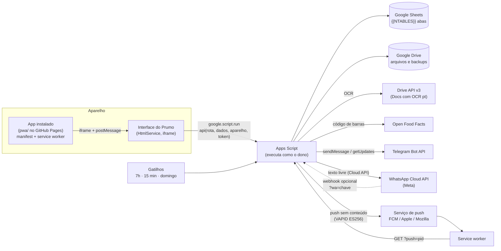

<p align="center">
  
</p>

<h1 align="center">Prumo</h1>

<p align="center"><b>Sua vida no prumo.</b><br>
Finanças, treinos, alimentação, tarefas, metas e rotinas em um único app pessoal, sobre Google Apps Script, Google Sheets e Google Drive.</p>

<p align="center">
  Versão {{VERSION}} · pt-BR · R$ · America/Sao_Paulo · Sem servidor próprio, sem mensalidade
</p>

---

## Sumário

1. [Visão geral](#1-visão-geral)
2. [Funcionalidades](#2-funcionalidades)
3. [Arquitetura](#3-arquitetura)
4. [Estrutura do projeto](#4-estrutura-do-projeto)
5. [Banco de dados](#5-banco-de-dados)
6. [API do servidor](#6-api-do-servidor)
7. [Gatilhos automáticos](#7-gatilhos-automáticos)
8. [Login, usuários e segurança](#8-login-usuários-e-segurança)
9. [App instalável (PWA) e notificações push](#9-app-instalável-pwa-e-notificações-push)
   - [9A. WhatsApp (API oficial da Meta)](#9a-whatsapp-api-oficial-da-meta)
   - [9B. Telegram (grátis, recomendado)](#9b-telegram-grátis-recomendado)
   - [9C. Alarmes](#9c-alarmes)
   - [9D. Estudos: leitor de PDF e Telegram](#9d-estudos-leitor-de-pdf-e-telegram)
10. [Instalação passo a passo](#10-instalação-passo-a-passo)
11. [Configuração](#11-configuração)
12. [Funções para rodar no editor](#12-funções-para-rodar-no-editor)
13. [Cálculos e fórmulas](#13-cálculos-e-fórmulas)
14. [Design](#14-design)
15. [Limites do Google](#15-limites-do-google)
16. [Solução de problemas](#16-solução-de-problemas)
17. [Testes](#17-testes)
18. [Histórico de versões](#18-histórico-de-versões)

---

## 1. Visão geral

O Prumo é um app de controle pessoal que reúne seis áreas da vida num lugar só e cruza as informações entre elas. Um aporte na reserva de emergência faz andar a meta "Juntar 10 mil". O treino de hoje aparece no "Seu dia". As calorias gastas no treino aumentam as calorias disponíveis no diário alimentar. Uma meta de água avança sozinha com o que você registra no diário.

| | |
|---|---|
| **Onde roda** | Web App do Google Apps Script. Funciona no navegador do computador e do celular, e também como app instalado (PWA). |
| **Onde ficam os dados** | Uma planilha Google Sheets com {{NTABLES}} abas, uma por tabela. Os arquivos (comprovantes, fotos, rótulos) ficam numa pasta do Google Drive. |
| **Quem acessa** | Qualquer pessoa com o link e a senha de acesso. Cada e-mail tem os próprios dados. |
| **Custo** | Zero. Usa só a conta Google do dono. |
| **Interface** | Mobile-first, tema escuro (padrão) e claro, fonte Plus Jakarta Sans, ícones próprios em SVG, sem emojis. |

### Destaques

- **Local-first.** O app carrega tudo de uma vez e grava em segundo plano. A tela muda na hora e volta atrás se o servidor recusar ("escrita otimista").
- **Desfazer.** Toda exclusão é lógica e mostra "Desfazer" por alguns segundos.
- **Auditoria completa.** Cada gravação fica registrada com o antes e o depois, quem fez, quando e de qual aparelho.
- **OCR em português.** Foto do cupom fiscal, do comprovante Pix ou do rótulo nutricional vira lançamento ou alimento preenchido.
- **Push no celular.** Lembretes chegam com o app fechado, quando ele está instalado.
- **Telegram.** Avisos, resumo do dia e comandos (/hoje) num bot próprio, grátis e sem servidor.
- **WhatsApp opcional.** Módulo pronto para a API oficial da Meta, que exige verificação da empresa (CNPJ/MEI).
- **Instala como app.** Ícone na tela inicial, abre em tela cheia, atalhos para os módulos.

---

## 2. Funcionalidades

### 2.1 Início

O painel do dia, que junta tudo:

- Saudação e semana em fita, para navegar pelos dias.
- **Seu dia:** rotinas, tarefas, eventos, treinos e contas do dia em ordem de horário. Dá para marcar como feito ali mesmo.
- Cartões rápidos: calorias restantes (anel), água (com botão +250 ml), rotinas feitas, treinos na semana.
- Sequência de dias ativos (chama).
- Para quem está começando: atalhos para o primeiro cadastro e o botão de carregar dados de exemplo.
- **Central de notificações** (sino): contas a vencer, faturas, tarefas atrasadas, metas em risco, lembretes e rotinas. Marca como lida e abre a tela certa.
- **Busca global** (Ctrl K ou ícone de lupa): encontra lançamentos, tarefas, metas, rotinas, exercícios e alimentos, e executa ações ("novo lançamento", "iniciar treino").
- **Botão +:** atalho de criação para todos os módulos.

### 2.2 Finanças

| Tela | O que faz |
|---|---|
| **Resumo** | Saldo em contas, patrimônio (contas + reservas + investimentos − dívidas), receitas e despesas do mês com comparação ao mês anterior, resultado e % da renda, projeção de gastos até o fim do mês, gastos dos últimos 7 dias, fluxo de caixa de 6 meses, despesas por categoria (rosca), próximos vencimentos e orçamento. |
| **Lançamentos** | Lista agrupada por dia com totais. Filtros (tipo, período, busca por texto ou valor), seleção múltipla (pagar, recategorizar, excluir em lote), deslizar para ações. |
| **Novo lançamento** | Receita, despesa ou transferência. Teclado de valor em centavos, categoria com subcategoria, conta ou cartão, forma de pagamento, estabelecimento, tags, observação e anexo do comprovante. Parcelamento no cartão (gera as N parcelas nas faturas certas), recorrência (mensal, semanal etc.), duplicar e status pago/pendente/agendado. Sugere a categoria pela regra do estabelecimento. |
| **Escanear comprovante** | Foto ou PDF do cupom ou do Pix → OCR → valor, data, estabelecimento e categoria preenchidos. O arquivo fica anexado. |
| **Contas** | Contas correntes, poupança, carteira e corretora. Saldo calculado, extrato da conta e **reconciliação** (informe o saldo real e o app cria o ajuste). |
| **Cartões** | Limite usado e disponível, faturas abertas, fechadas e pagas, itens da fatura, **pagar fatura** (gera a saída na conta) e **simulador de compra parcelada** (mostra o impacto nas próximas faturas). |
| **Orçamento** | Limite por categoria no mês, barra de consumo com alerta, copiar do mês anterior. |
| **Contas a pagar** | Agenda dos pendentes e das recorrências, gerar lançamentos do mês, pausar uma recorrência. |
| **Reservas e investimentos** | Caixinhas com meta e progresso, aportes e resgates (saem e entram das contas), investimentos por tipo com rentabilidade. |
| **Dívidas** | Saldo, juros e parcelas. Plano de quitação **avalanche** (maior juros primeiro) ou **bola de neve** (menor saldo primeiro), com valor extra por mês e data estimada de quitação. |
| **Relatórios** | Período de 3, 6 ou 12 meses: evolução de receitas e despesas, categorias, maiores gastos, médias. Exporta CSV e versão para impressão. |
| **Categorias e regras** | Categorias e subcategorias com cor e ícone. Regras do tipo "se o texto contém X, a categoria é Y". |
| **Importar extrato** | CSV ou OFX do banco: mapeamento de colunas, inversão de sinal, prévia e **sem duplicar** (hash de importação). |

### 2.3 Fitness

| Tela | O que faz |
|---|---|
| **Resumo** | Treino do dia, treinos na semana contra a meta, volume, sequência, peso atual e passos. |
| **Treinos (fichas)** | Fichas por objetivo e nível, dias da semana, exercícios com séries, repetições, carga, descanso e ordem. Modelos prontos, duplicar ficha. |
| **Modo foco** | Treino guiado em tela cheia: série por série, carga e repetições anteriores, **descanso automático** com contagem regressiva e bipes, tela sempre acesa. No fim calcula volume, kcal estimadas, e1RM e **recordes pessoais**. |
| **Exercícios** | Biblioteca com 86 exercícios por grupo muscular e equipamento, mais os seus. |
| **Timers** | Cronômetro, regressivo, intervalado, EMOM e Tabata, com presets salvos e som. |
| **Histórico** | Sessões feitas, com detalhe de cada série. |
| **Evolução** | Força por exercício (e1RM ao longo do tempo), medidas corporais, peso e % de gordura, fotos de progresso com comparação lado a lado. |
| **Cardio** | Corrida, bike etc. com distância, tempo, ritmo e kcal (MET). Registro de passos. |
| **Calculadoras** | IMC e faixa saudável, TMB e gasto diário, % de gordura (Marinha), 1RM (Epley/Brzycki), zonas de frequência cardíaca. |

### 2.4 Alimentação

| Tela | O que faz |
|---|---|
| **Diário** | Refeições do dia (café, almoço, lanche, jantar, ceia) com kcal e macros, anel de calorias restantes (soma o gasto do treino se você quiser), água com copos rápidos, copiar um dia, refeições favoritas. |
| **Adicionar alimento** | Busca na base própria com 115 alimentos (TACO aproximada), **código de barras** (câmera com leitura automática ou digitação, consulta a Open Food Facts) e **OCR do rótulo**. |
| **Nutrientes** | Micronutrientes do dia com % do valor diário, ou a **média por dia** de 7 dias, 30 dias, um mês ou um intervalo de datas. |
| **Meta de água** | Toque no total do cartão de água para escolher quantos litros beber por dia (1,5 a 4 L ou outro valor), ou volte ao cálculo automático (35 ml por kg). |
| **Alarmes** | Lembretes de água (a cada N horas, com opção de parar quando a meta do dia for batida), refeições e remédios. Veja a [seção 9C](#9c-alarmes). |
| **Metas e calculadora** | Objetivo (perder, manter, ganhar), TMB por Mifflin-St Jeor ou Katch-McArdle, nível de atividade, ritmo por semana, macros e água, com **limites de segurança** (validados também no servidor). |
| **Meus alimentos / Receitas** | Cadastro próprio. Receita soma os ingredientes e divide por porções. |
| **Relatórios** | Médias de calorias, macros e água, aderência à meta e **TDEE adaptativo** (estimado pelo peso real com média móvel), em 7 dias, 30 dias, mês, 90 dias, ano ou intervalo. |

### 2.5 Tarefas

| Tela | O que faz |
|---|---|
| **Hoje** | Atrasadas, de hoje e sem data, com prioridade, projeto, subtarefas e concluir com um toque. |
| **Próximas / Pendências** | Os próximos dias agrupados. Pendências antigas com "reagendar tudo". |
| **Quadro** | Kanban (a fazer, fazendo, feito) por projeto. |
| **Agenda** | Dia, semana e mês, com eventos (dia inteiro, local, lembrete) e tarefas. Envio opcional ao Google Agenda (conta dona). |
| **Projetos** | Projetos com cor, progresso e arquivamento. |
| **Foco** | Pomodoro ligado a uma tarefa, com ciclos e pausas. |
| **Concluídas / Estatísticas** | Histórico e produtividade por dia, semana e projeto. |
| **Lembretes** | Minutos antes do vencimento: notificação no app, push no celular e e-mail. |
| **Alarme da tarefa** | No editor da tarefa, escolha **Alarme** (na hora, 5, 10, 15, 30 min, 1 h ou 1 dia antes). Toca no app com som e tela cheia, com o botão **Concluir tarefa**. |

### 2.6 Metas

| Tela | O que faz |
|---|---|
| **Visão** | Metas por horizonte (curto, médio, longo) e área da vida, com progresso, ritmo ("no ritmo", "atrasada") e prazo. |
| **Detalhe da meta** | Anel de progresso, atual, alvo, início e prazo, ritmo necessário por semana, gráfico de evolução, motivo ("por que importa"), **marcos**, **check-ins** com humor e anotação, e **vínculos** com tarefas, rotinas e reservas. |
| **Medição automática** | A meta anda sozinha a partir de outro módulo: saldo de uma reserva, peso (fitness ou alimentação), tarefas concluídas, execuções de uma rotina, água. |
| **Roda da vida** | Notas de 0 a 10 por área, com histórico. |
| **Linha do tempo** | Metas e marcos no calendário. |
| **Revisão da semana** | Roteiro guiado: o que avançou, o que travou, próximos passos. |
| **Concluídas e arquivadas** | Histórico das metas encerradas. |

### 2.7 Rotinas

| Tela | O que faz |
|---|---|
| **Hoje** | Linha do tempo com blocos de horário, hábitos e checklists. Marcar feito, parcial ou pulado, e os itens do checklist. |
| **Semana / Mês / Ano** | Planejamento em blocos de horário, calendário mensal e mapa de calor anual. |
| **Hábitos** | Sequência atual e recorde, taxa de cumprimento. |
| **Modelos** | Rotinas prontas (manhã produtiva, bloco de estudo, semana de treino, preparo de refeições) para adicionar com um toque. |
| **Estatísticas** | Cumprimento por categoria e dia da semana. |
| **Cadastro** | Frequência diária, semanal (dias), mensal, anual ou a cada N dias. Modo bloco, hábito ou checklist. Horário de início e fim, cor e ícone. Vínculo com treino, diário, tarefa ou meta. |
| **Aviso de início** | Notificação (e push) quando a rotina com horário está para começar. |

### 2.7A Estudos — concursos públicos

Módulo carregado **sob demanda**: as tabelas de Estudos não entram na carga inicial do app (rota `est.boot`), então o Início continua leve. Telas em **Estudos** (abas Painel, Questões, Revisões e o menu **Mais**):

| Tela | O que faz |
|---|---|
| **Painel** | Concurso em foco, próxima atividade (tarefa do plano ou ciclo), hoje, tempo líquido da semana contra o previsto, questões e precisão dos últimos 7 dias (com o tamanho da amostra), cobertura do edital, assuntos com domínio baixo, último simulado. **Gráficos:** assertividade × erro (rosca), certas × erradas por semana, horas de estudo × meta semanal (linha tracejada; meta definida no próprio cartão) e precisão por disciplina. Cartões configuráveis; cada número abre os registros que o compõem. |
| **Concursos e editais** | Concursos com órgão, cargo, banca, **tipo de concurso (área: bancária, tribunais, fiscal…)**, situação e **data da prova com status** (confirmada, estimada ou indefinida) e fonte. Etapas (inscrição, isenção, pagamento, prova, gabaritos, recursos, resultado…) com checklist, evento na agenda e lembrete. |
| **Edital verticalizado** | Disciplinas, assuntos e subassuntos com teoria, questões, precisão e domínio por assunto. **Versões** do edital (retificação): a nova versão mostra o que foi adicionado, alterado e retirado, sem apagar o histórico. **Leitura do edital** pelo PDF (da biblioteca ou do computador), por texto colado ou por tabela colada do Excel/Planilhas: preenche Disciplina, Assunto, Subassunto, Item, Página, Peso e Questões; tudo fica editável e passa pela prévia antes de gravar. |
| **Planejamento** | Disponibilidade por dia, tamanho da sessão, pausas e folga para imprevistos. A sugestão mostra a conta (peso, domínio, revisões vencidas, proximidade da prova) e você escolhe o que vira tarefa. Ciclo de estudos. |
| **Biblioteca** | PDFs, planilhas, imagens, links, livros e aulas, com código (M1, M2…), versões do arquivo, favoritos, situação e lixeira. **Categoria** (Questões, Revisões, Teoria, Flashcards, Outros) e concurso escolhidos ao guardar (categoria obrigatória; planilha vem sugerida como Questões e, se guardada em Questões/Flashcards, o app oferece importar). No Drive: `Estudos/u-…/<PDFs|Planilhas|Imagens|Outros>/<Concurso ou Geral>/<data do envio>/<Categoria>/arquivo`; mudar categoria ou concurso (inclusive em lote) move o arquivo, sem mudar id, hash ou links. *Reorganizar* mostra a prévia (quantos e para onde) e move os antigos (sem categoria → Outros). Filtro por categoria e caminho da pasta no material. Pelo Telegram, o bot pergunta a categoria (lista numerada; sem resposta, fica em Outros) e depois a disciplina. Envio em blocos (até 50 MB), retomável, e **sem duplicar** (o mesmo arquivo é reconhecido pelo hash). Planilha pode ser só guardada ou importada. |
| **Leitor de PDF** | Ver seção [9D](#9d-estudos-leitor-de-pdf-e-telegram). |
| **Sala de estudo** | Uma sessão aberta por vez, cronômetro de tempo líquido (início, fim e pausas), Pomodoro opcional, anotações rápidas, encerramento com páginas estudadas, questões feitas fora do banco, dúvidas e próximo passo. Sessão manual e correção de horário (com motivo). |
| **Questões** | Banco com filtros (inéditas, erradas, favoritas, com dúvida, comentadas, a revisar, sem gabarito, anuladas, **concurso**, **tipo de concurso (área)**, banca, disciplina, assunto, ano, dificuldade, tipo, origem). **Cartões de assertividade × erro** (% de acertos, quantidade de certas, erradas e não respondidas, pela última resposta de cada questão do filtro ou da seleção). **Selecionar todas** ou uma a uma e **excluir em lote** (com desfazer). Importar e incluir já com concurso e área. **Treino** corrige na hora; **avaliação** corrige no fim. Ao resolver de novo, a resposta anterior fica **oculta** atrás de "Exibir resposta anterior"; vale sempre a última. **Comentário** por questão e **Resposta por IA** (a IA resolve sem ver o gabarito, explica e compara; você pode usar como comentário ou, se a questão não tem gabarito, como gabarito preliminar). Envio de uma série de questões para treinar no Telegram. Gabarito com situação (preliminar, definitivo, anulada, sem gabarito) e histórico; mudar o gabarito de questão já respondida pede o motivo e recalcula as tentativas **mantendo o resultado original**. Listas manuais, aleatórias, de dificuldades e filtros salvos. |
| **Simulados** | **Simulado com tempo** em um passo: quantidade, minutos, origem (aleatórias, só as que errei, só inéditas, filtro atual ou seleção), concurso, área, disciplinas e tipo de questão. Montagem por blocos (disciplina, assunto, banca, quantidade, peso, mínimo) ou a partir de lista. **Regras de pontuação informadas por você** (acerto, erro, branco, anulada, mínimos); o Prumo não supõe penalização pelo nome da banca. Cartão-resposta, marcar para revisar, cronômetro, salvamento a cada 20 s e retomada. O gabarito é congelado no início: se mudar depois, o resultado da prova não muda (a mudança é avisada na correção). Comparação com simulados equivalentes. |
| **Revisões** | Revisões espaçadas (padrão 1, 7, 15, 30, 60, 120 dias, editável): errei, difícil, bom, fácil. Atrasadas destacadas. |
| **Flashcards** | Cartões básicos, de lacuna, com imagem ou áudio; agendamento SM-2; relatório em PDF ou planilha (Estudos › Relatórios). |
| **Caderno de erros** | Causa, raciocínio, explicação, ação e próxima tentativa; erro recorrente soma ocorrências. |
| **Resumos e anotações** | Resumo, fichamento, Cornell, mapa, nota, lei seca e dúvida, em Markdown simples, com versões, vínculos e fonte. **Resumos de PDF com IA** (modos Objetivo, Direcionado e Detalhado; PDF grande em blocos de páginas com progresso e cancelar) viram rascunho com prévia: aprovar, editar (versões), excluir com desfazer, mover, duplicar, regenerar (nova versão) e compartilhar (Telegram, copiar, compartilhar do aparelho, PDF, imprimir). |
| **Discursivas** | Proposta, critérios, texto com versões e avaliações (você, outra pessoa, resultado oficial ou sugestão de IA identificada). Com a IA: **revisar e corrigir** (a nota por critério, b pontos fortes, c problemas por trecho, d trechos reescritos, e plano de reescrita; os trechos aceitos viram nova versão), **temas e propostas** (marcados como sugestão, sem estatística inventada), **texto de exemplo** (material de referência marcado "Gerado por IA") e **Treinar** (proposta + cronômetro). |
| **Desempenho e histórico** | Indicadores com denominadores visíveis ("sem dados" quando não há base), por período, concurso e disciplina; relatório PDF ou planilha (XLSX) e envio ao Telegram. |
| **Relatórios** | (a) resumos e anotações por disciplina, com sumário; (b) flashcards; (c) questões sorteadas (50 por padrão) com **folha de gabarito na última página** (sem gabarito aparece como "sem gabarito"); (d) **relatório completo** com sumário, gerado em blocos com progresso e cancelar. PDF, planilha, imprimir e Telegram. |
| **Assistente de IA** | Ver seção [9E](#9e-estudos-assistente-de-ia). Conversar, gerar resumo, questões e flashcards com fontes (biblioteca, Drive, anotações, questões, edital, meus dados), escolhendo o modelo na hora. |
| **Preferências** | Intervalos de revisão, leitor de PDF, avisos de estudo no Telegram, provedores de IA, verificação de arquivos no Drive. |

**Integrações:** Início (revisões do dia e etapas de concurso no "Seu dia"), busca global (materiais, assuntos, anotações, questões, concursos e ações), Tarefas (atividades do plano são tarefas), Foco (Pomodoro de tarefa de estudo também vira sessão, sem contar duas vezes), Metas (horas, questões, precisão, revisões, discursivas e cobertura como medição automática), Rotinas (vínculo "Sessão de estudo"), Notificações, Logs e Backup.

**Leitura do edital (PDF ou texto):** no PDF, o Prumo extrai o texto página por página e procura a seção *Conteúdos Programáticos*. Lá ele reconhece:
- os **cargos** ("NOME DE RELACIONAMENTO: AGENTE COMERCIAL", "CARGO 2: …"). Quando o edital tem conteúdo diferente por cargo, aparece o campo **Cargo**, já escolhido pelo cargo cadastrado no concurso;
- as **disciplinas** ("LÍNGUA PORTUGUESA: 1 - …") e os **itens** pela numeração em sequência (aceita "1 -", "1.", "1 –", "7 -Texto", "17- Texto" e o número quebrado na linha);
- os **subassuntos**: subitens 1.1, 1.2 ou as partes depois de "Título:" separadas por ";";
- a **página** do PDF onde cada item começa;
- o **quadro de provas** ("Língua Portuguesa: 10 questões com valor de 1,5 ponto cada"), que preenche **Questões** e **Peso** (valor de cada questão) da disciplina no cargo escolhido.

Testado com o edital do Banco do Brasil 2022 (122 linhas para Agente Comercial, 8 disciplinas, páginas 33 a 35). Editais com outro layout podem precisar de ajustes na tabela antes de gravar; PDF digitalizado (só imagem) não tem texto para ler. Colando uma **tabela** (TSV do Excel, CSV com ";" ou ","), cada coluna vai para o seu campo pelo cabeçalho (repetido ou não) e o peso aceita vírgula ("1,5"). Linhas repetidas são ignoradas na gravação.

**Importação de planilha (XLSX ou CSV):** primeira linha com os nomes das colunas. O app gera o modelo no seu Drive. Colunas extras aceitas: `texto_base` (texto de apoio) e `pagina`.

**Importação de PDF de questões** (Questões › *PDF de questões*, no importador ou no menu de um PDF da biblioteca): o app lê o PDF no navegador (PDF.js, com as posições do texto) e monta as linhas no formato do modelo XLSX.
- **Layout:** uma ou duas colunas, cabeçalhos e números de página descartados, linhas e hifenização juntadas, parágrafos preservados, tabelas em texto com as colunas separadas por `|`.
- **Questão:** número (`12. (CESGRANRIO – 2015)`, `12 (FCC – TRT – Analista – 2022)`, `Questão 12`, `1. Ano: 2022 Banca: FGV Órgão: … Prova: …`), banca, ano, órgão e cargo, **enunciado completo**, alternativas `a)`/`A)`/`(A)` de A–E ou A–D (inclusive várias na mesma linha ou impressas no meio da linha anterior), certo/errado (C/E, V/F).
- **Texto de apoio:** "Leia o texto…", "Texto II", "Texto para os itens de 1 a 3", "Read the text…". O texto é separado da pergunta (com título e fonte, "Disponível em… Adaptado.") e repetido nas questões seguintes que falam dele (pelo intervalo citado, por "o texto/trecho/fragmento", por citação entre aspas ou pelo mesmo assunto).
- **Disciplina e assunto:** pelo sumário (página impressa), pelo cabeçalho lateral e pelos títulos (`Æ …`) e subtítulos.
- **Gabarito:** tabelas "GABARITO" (uma por disciplina ou no fim; números que se repetem viram a sequência seguinte), `1-B 2-C`, `1 E 2 C 3 C`, ou "Gabarito: B" depois da questão; "ANULADA"/"*" vira anulada. Comentário/Resolução vira explicação.
- **Figuras, fórmulas e tabelas:** a área da questão é recortada da página (todas as partes, em colunas e páginas diferentes) e anexada como imagem; alternativas que só existem em imagem ficam marcadas.
- **Conferência antes de gravar:** resumo (questões, com gabarito, com texto, com recorte, por disciplina), **avisos com a página** (numeração pulada, número impresso errado corrigido pela sequência, gabarito sem questão, alternativas sem letra), **percentual do texto do PDF aproveitado** com as linhas que ficaram fora, edição de qualquer questão ao lado da página do PDF, desmarcar questões, prefixo do código, banca/órgão/cargo/concurso/área e situação do gabarito.
- **Saída:** *Baixar XLSX* ou *Salvar XLSX no Drive* (formato do modelo + texto de apoio e página) e/ou **Importar**: o PDF vai para a biblioteca (cada questão abre na página dela), os recortes são enviados ao Drive e as questões são gravadas em blocos; reimportar atualiza pelo código, sem duplicar.
- **Testado** com o caderno "1.200 Questões para o Banco do Brasil" (186 páginas, duas colunas): 1.199 questões (o livro não tem a 166 de Português), 9 disciplinas com as contagens do sumário, gabarito em todas, 342 com texto de apoio, 42 com recorte, 99,99% das linhas aproveitadas (a única fora é um "3" solto impresso na página 12). PDF só de imagem (digitalizado) não tem texto para ler.

| Tabela | Colunas | Identificação na reimportação |
|---|---|---|
| Questões | `codigo, tipo (multipla, C/E, curta, discursiva), enunciado*, a, b, c, d, e, gabarito, gabarito_status, explicacao, banca, orgao, cargo, ano, disciplina, assunto, dificuldade, fonte, tags` | `codigo` |
| Flashcards | `baralho, frente*, verso, disciplina, assunto, tags` | `baralho + frente` |
| Edital | `disciplina*, assunto*, subassunto, item_ref, pagina, peso, qtd_questoes, descricao` | `disciplina + assunto` |

A importação sempre passa por **Conferir** (erros por linha); você pode importar só as linhas válidas. Reimportar atualiza o que foi identificado, guardando versão e histórico do gabarito.

### 2.8 Configurações

Conectado como (e-mail) · **Sair** · **Telegram** (bot, conectar, avisos automáticos, resumo das 7h, limites e histórico) · Perfil (foto, nome, nascimento, sexo, altura, unidade de peso) · Aparência (escuro, claro, automático) · Preferências (início da semana, metas diárias, timers, somar calorias do treino) · Notificações (push no celular, rotinas, água, e-mail, resumo das 7h) · Segurança (PIN de 4 a 6 dígitos e bloqueio por inatividade) · Dados e backup (exportar e restaurar JSON, backup da planilha, modo demonstração) · Integrações (Google Agenda, Open Food Facts, gatilhos) · Arquivos (tudo o que foi enviado, com miniatura, renomear e lixeira) · Logs (auditoria e erros com filtros e exportação) · Sobre e diagnóstico.

### 2.9 Recursos transversais

- **Login** por e-mail e senha de acesso. Cada e-mail é um usuário separado ([seção 8](#8-login-usuários-e-segurança)).
- **PIN local** para bloquear o app no aparelho.
- **Escrita otimista com desfazer**, validação no cliente e no servidor e mensagens de erro no campo certo.
- **Atalhos de teclado** no computador: Ctrl K (busca), N (novo), Esc (fechar).
- **Acessibilidade:** alvos de toque de 44 px (botões, chips, abas e campos no celular), foco visível, rótulos ARIA, contraste mínimo de 4,5:1 conferido por teste nos dois temas.
- **Relatórios (motor único):** cada tela descreve o relatório e o mesmo motor gera o **PDF A4 compacto** (cabeçalho com filtros, rodapé "p. X de Y", cabeçalho de tabela repetido na quebra, sumário quando pedido) e a **planilha XLSX** (aba Resumo + uma aba por tabela, números e datas como valores). Botão **Relatório** em Finanças (Lançamentos e Relatórios), Fitness (Evolução), Alimentação (Relatórios), Tarefas (Estatísticas), Metas, Rotinas (Estatísticas), Estudos (Desempenho e Relatórios) e Logs, sempre com o período e os filtros ativos: baixar PDF, baixar planilha, imprimir (iframe oculto; se o navegador bloquear, abre o PDF numa aba) e enviar ao Telegram. **CSV só para importação.**
- **Filtros em todas as listas e relatórios:** período (mês ou ano com setas, 7, 30 ou 90 dias, 3, 6 ou 12 meses, intervalo de datas, tudo), tipo, conta, projeto, prioridade, categoria, área e busca, conforme a tela. Toque no nome do período para voltar ao atual. Quando o período começa antes dos meses carregados na abertura, o app busca o histórico no servidor sozinho.

| Tela | Filtros |
|---|---|
| Finanças › Lançamentos | Mês, ano, 90 dias, intervalo, tudo · tipo · busca · conta, cartão, categoria, tag e valor |
| Finanças › Conta (extrato) | Período · entradas, saídas, pendentes |
| Finanças › Contas a pagar | A pagar / a receber · conta ou cartão |
| Finanças › Relatórios | Mês, 3/6/12 meses, ano, intervalo, tudo · conta ou cartão (também vale para o relatório PDF/XLSX) |
| Finanças › Cartões | Faturas pagas por ano |
| Fitness › Treinos / Histórico / Cardio / Evolução | Dia da semana e objetivo · período, treinos ou cardio, ficha · período e atividade · período do peso, medidas, fotos e força |
| Alimentação › Nutrientes / Relatórios / Receitas | Dia ou média do período · período · busca |
| Tarefas › Próximas / Pendências / Quadro / Concluídas / Estatísticas | Horizonte (7 a 90 dias), prioridade, projeto e busca · período de conclusão · período (semanas ou meses no gráfico) |
| Tarefas e Alimentação › Alarmes | Tipo (água, refeições, remédios, tarefas, outros) |
| Metas › Visão / Linha do tempo / Concluídas | Horizonte, área e busca · prazo, situação e área · período, situação e área |
| Rotinas › Estatísticas / Todas | Período e categoria · situação, categoria, frequência e busca |
| Configurações › Arquivos / Logs | Período, tipo e nome · nível, módulo, data e busca |

---

## 3. Arquitetura



**Servidor (Apps Script V8).** Tem um único ponto de entrada, `api(rota, dados, aparelho, token)` (e `apiBatch` para várias chamadas numa ida só), com uma lista fechada de rotas. A resposta sempre vem num envelope `{ ok, data, error: { code, message, field }, meta: { ms } }`. O acesso à planilha passa por um repositório genérico (`Db`) dirigido por esquema:

- Lê cada aba no máximo uma vez por requisição, usando a Sheets API em lote (`batchGet`) na carga inicial.
- Mantém um cache versionado e fragmentado (`CacheService`) entre requisições. A invalidação custa O(1) por versão.
- Valida e converte tipos, preenche as colunas de sistema e grava em lote.
- Usa `LockService` (reentrante) para evitar gravações simultâneas.
- Protege contra injeção de fórmula: valores que começam com `=`, `+`, `-` ou `@` são gravados como texto.

**Cliente (JavaScript puro, ES2020).** Fica no namespace `window.Prumo`:

| Parte | Função |
|---|---|
| `P.h` | Templates HTML com escape automático. |
| `P.store` | Dados em memória com escrita otimista e rollback. |
| `P.api` | Promise, timeout, novas tentativas e deduplicação. |
| `P.router` | Rotas por `#/hash`. |
| `P.ui` | Painéis, diálogos, toasts e formulários. |
| `P.charts` | Chart.js 4. |
| `P.calc` | Fórmulas, espelho do `Calc.gs`. |

O HTML é montado com `include()` e não tem scriptlets.

**Carga inicial.** A rota `boot` devolve perfil, preferências e os dados de todos os módulos. As tabelas grandes vêm só numa janela recente (lançamentos dos últimos 25 meses, diário alimentar de 6 meses…). O saldo anterior das contas chega já somado (`finBase`).

---

## 4. Estrutura do projeto

```
prumo/
├── src/                      # projeto do Apps Script
│   ├── appsscript.json       # manifesto: V8, fuso, serviços avançados (Drive v3, Sheets v4), escopos, web app
│   ├── Config.gs             # CONFIG (IDs, login, limites) e SCHEMA de todas as tabelas
│   ├── Utils.gs              # datas, dinheiro, uuid, sha256, erros padronizados
│   ├── Cache.gs              # cache versionado e fragmentado
│   ├── Db.gs                 # repositório genérico sobre o Sheets
│   ├── Auth.gs               # usuário da requisição, perfil, preferências, PIN
│   ├── Login.gs              # login por senha, sessões (token), bloqueio por tentativas
│   ├── Logger.gs             # AppLog: auditoria e erros em lote
│   ├── Api.gs                # doGet, include, api/apiBatch, rotas, boot
│   ├── Files.gs              # upload ao Drive, miniaturas, lixeira
│   ├── Ocr.gs                # OCR e leitura de cupom, Pix e rótulo
│   ├── Finance.gs            # parcelas, faturas, recorrências, reconciliação, importação
│   ├── Fitness.gs            # fechamento de sessão (volume, kcal, e1RM, recordes)
│   ├── Nutrition.gs          # código de barras (Open Food Facts) e meta segura
│   ├── Tasks.gs              # lembretes e Google Agenda
│   ├── Goals.gs              # medição automática e ritmo das metas
│   ├── Routines.gs           # agenda de rotinas do dia
│   ├── Notifications.gs      # central de notificações, avisos com hora, resumo por e-mail
│   ├── Push.gs               # Web Push: VAPID (ECDSA P-256), inscrições, envio e entrega
│   ├── Telegram.gs           # Bot API: conexão por link, leitura (getUpdates), envio, comandos, resumo
│   ├── WhatsApp.gs           # Cloud API da Meta: envio de texto, limites, janela de 24 h, webhook opcional
│   ├── Alarms.gs             # alarmes: horários, disparo pelo gatilho de 5 min, alarm.ack
│   ├── Triggers.gs           # gatilhos diário, 15 min, 5 min e semanal
│   ├── Backup.gs             # cópia da planilha, exportar e importar JSON
│   ├── Setup.gs              # instalação idempotente (abas, formatos, pastas, dados, gatilhos)
│   ├── Seed.gs               # categorias, 86 exercícios, 115 alimentos, timers, modelos de rotina
│   ├── SeedDemo.gs           # dados de demonstração (ids "demo-")
│   ├── Calc.gs               # fórmulas puras + autoteste
│   ├── Index.html            # casca da página
│   ├── icons.html            # sprite SVG de ícones
│   ├── css_*.html            # tokens (temas), base, componentes, módulos
│   └── js_*.html             # core, ui, filters (período/tipo/busca), charts, calc, login, pwa, alarms, telegram, whatsapp e um arquivo por módulo
├── dist3/                    # versão para colar no editor (3 arquivos)
│   ├── Codigo.gs             # todo o servidor
│   ├── Index.html            # toda a interface (scripts protegidos contra o pré-processamento do Google)
│   └── appsscript.json
├── pwa/                      # app instalável (publicar no GitHub Pages)
│   ├── index.html            # abre o Prumo em tela cheia, splash, permissão de push, instalação
│   ├── sw.js                 # service worker: cache, push, clique na notificação
│   ├── manifest.webmanifest  # nome, cores, ícones (inclui maskable) e atalhos
│   ├── config.js             # URL do Web App (/exec)
│   └── icons/                # 192, 512, maskable, apple-touch, badge, favicon
└── logo/                     # marca em SVG e PNG
```

---

## 5. Banco de dados

### 5.1 Convenções

- **Uma aba por tabela.** A linha 1 é o cabeçalho, uma linha por registro. As abas e colunas são criadas pelo `setup()`, que pode rodar de novo sem estragar nada (migração não destrutiva: colunas novas entram no fim). Se uma versão nova trouxer uma tabela e o `setup()` ainda não tiver rodado, a aba é criada sozinha no primeiro acesso.
- **Colunas de sistema** em todas as tabelas:

  | Coluna | O que guarda |
  |---|---|
  | `id` | UUID v4 |
  | `user_id` | **E-mail de quem criou o registro** |
  | `created_at`, `updated_at` | Data e hora ISO com fuso |
  | `deleted_at` | Exclusão lógica |

- **Isolamento por usuário.** Toda leitura filtra por `user_id` = e-mail logado, e toda gravação confere o dono.
- **Auditoria.** Cada criação, edição e exclusão gera uma linha em `logs` com `antes_json` e `depois_json`, em nome do usuário.
- **Formatos.** Colunas de texto, data e JSON são formatadas como texto puro (`@`) para o Sheets não converter "01/02" em data nem "1e3" em número. Listas viram validação de dados na planilha.

### 5.2 Mini-linguagem do esquema

Cada tabela está declarada em `SCHEMA` (Config.gs) como uma linha `nome:tipo[tamanho][(opções)][!][=padrão]`:

| Tipo | Significado | Tipo | Significado |
|---|---|---|---|
| `s` | texto curto (com limite) | `d` | data `aaaa-mm-dd` |
| `t` | texto longo | `dt` | data e hora ISO |
| `i` | inteiro | `b` | sim/não |
| `n` | número | `e(a,b,c)` | lista fechada |
| `m` | dinheiro (2 casas) | `j` | JSON |
| `r` | referência (id de outra tabela) | `!` / `=x` | obrigatório / valor padrão |

### 5.3 Tabelas ({{NTABLES}})

{{SCHEMA}}

---

## 6. API do servidor

Chamada do cliente: `google.script.run.api(rota, dados, aparelho, token)`.

- **Envelope:** `{ ok, data, error: { code, message, field }, meta: { ms } }`.
- **Códigos de erro:** `VALIDATION` (com o `field`), `NOT_FOUND`, `FORBIDDEN`, `AUTH` (sessão vencida, e o app volta ao login), `LOCKED`, `QUOTA`, `OCR_FAILED`, `UNKNOWN`. Erros inesperados vão para o log com a pilha de chamadas, e o usuário vê uma mensagem amigável.
- **Lote:** `apiBatch([{route, payload}, …], aparelho, token)`, até 20 chamadas por ida.
- **GET público** `?push=<pid>`: usado pelo service worker para buscar o conteúdo das notificações ([seção 9](#9-app-instalável-pwa-e-notificações-push)).
- **GET** `?hub.mode=subscribe&…` e **POST** `?wa=<chave>`: webhook opcional do WhatsApp ([seção 9A](#9a-whatsapp-api-oficial-da-meta)).

### Rotas ({{NROUTES}})

{{ROUTES}}

A rota `db.save` só grava as tabelas listadas em `CONFIG.CLIENT_WRITABLE`. As regras que mexem em vários registros (parcelas, faturas, aportes, importação) têm rotas próprias.

---

## 7. Gatilhos automáticos

Criados pelo `setup()` (ou por `setupTriggers()`). Rodam para **cada usuário** cadastrado.

| Gatilho | Quando | O que faz |
|---|---|---|
| `triggerReminders` | a cada 15 min | Lembretes de tarefas (notificação + e-mail), avisos de rotinas que vão começar e de eventos com lembrete, envio do **push** e, se autorizado, do **Telegram** e do **WhatsApp** (uma mensagem com os avisos novos). |
| `triggerFrequente` | a cada 5 min | **Alarmes** que venceram (notificação, push e, se autorizado, Telegram) e leitura das mensagens novas do bot (`getUpdates`): conexão de contas e comandos `/hoje`, `/parar`, `/ajuda`. Sem alarme ativo, só confere o Telegram. Substitui o antigo `triggerTelegram` (a função continua existindo para gatilhos antigos). |
| `triggerDaily` | todo dia às 7h | Gera os lançamentos recorrentes, fecha faturas vencidas, cria notificações (contas a vencer, faturas, tarefas atrasadas, metas em risco), envia o push, o **resumo do dia** no Telegram (para quem ligou) e por e-mail. |
| `triggerWeekly` | domingo às 3h | Backup da planilha (mantém as 8 últimas), limpeza dos temporários do OCR e das sessões vencidas (uma vez), retenção de logs e limpeza das notificações lidas antigas (por usuário). |

---

## 8. Login, usuários e segurança

### Como funciona o login

- O Web App é publicado como **"Executar como: Eu"** e **"Quem pode acessar: Qualquer pessoa"**. Qualquer um abre a página, mas sem login não vê dado nenhum: toda rota, menos `auth.login`, exige um token válido.
- A tela de entrada pede **e-mail** e **senha de acesso**. A senha é a mesma para todos e só existe como hash SHA-256 com sal: em `CONFIG.LOGIN.SENHA_SHA256` ou na propriedade `LOGIN_SENHA_SHA256` do script, se você trocar.
- No acerto, o servidor cria um **token aleatório** (64 caracteres) válido por 30 dias. O token fica no aparelho e o servidor guarda só o hash dele, com o e-mail e a validade (Script Properties, com cache na frente).
- **O e-mail digitado é o usuário.** Tudo que a pessoa cadastra recebe `user_id` = e-mail, e os logs também. Cada e-mail vê **só os próprios dados**. No primeiro acesso, o e-mail ganha categorias, exercícios, alimentos, timers, modelos de rotina e a conta "Carteira".
- **Bloqueio por tentativas:** 5 senhas erradas para o mesmo e-mail travam por 15 minutos. Cada tentativa errada vai para o log daquele e-mail.
- **Sair** (Configurações ou Perfil) apaga o token do aparelho e do servidor.

### Proteções

| Item | Como |
|---|---|
| Isolamento | Toda consulta filtra pelo e-mail da sessão. Gravar em registro de outra pessoa resulta em "não encontrado". |
| Rotas do dono | `sys.backup`, `sys.setupTriggers`, `tasks.calendar`, `wa.saveConfig`, `wa.testConnection` e `tg.saveConfig` mexem no Drive, nos gatilhos, na Agenda, na conta da Meta ou no bot do Telegram da conta dona, então só o e-mail dono do script pode usá-las. |
| Tokens (Meta e Telegram) | Ficam só nas propriedades do script. Nunca vão para a planilha, para o navegador (só os 4 últimos caracteres) nem para os logs; erros do Telegram têm o token apagado antes de registrar. |
| XSS | Todo texto entra no HTML escapado pelo `P.h`. Valores crus só por `raw()` explícito. |
| Fórmulas | Texto que começa com `=`, `+`, `-` ou `@` é gravado como texto literal. |
| Arquivos | Ficam privados no Drive do dono. O app entrega o conteúdo pelo servidor, sem link público. |
| PIN | Hash SHA-256 por usuário. Bloqueio por inatividade. |
| Senha | `definirSenha('nova')` troca a senha, `encerrarSessoes()` derruba todo mundo. |

> **Atenção:** como a senha é compartilhada e não há confirmação de e-mail, quem sabe a senha consegue entrar digitando o e-mail de outra pessoa. Passe a senha só para quem você confia e troque-a se ela vazar.

---

## 9. App instalável (PWA) e notificações push

### Por que existe a pasta `pwa/`

Página de Apps Script não pode ter manifesto nem service worker, porque o Google serve o HTML dentro de iframes no domínio dele. Por isso o "Adicionar à tela inicial" do link `/exec` cria só um atalho, e o navegador não deixa receber push.

A pasta `pwa/` é uma **casca** publicada num endereço próprio (GitHub Pages, gratuito). Ela tem:

- `manifest.webmanifest`: nome, ícones (inclusive *maskable* para Android), cor, tela cheia (`standalone`) e atalhos para Finanças, Tarefas, Fitness e Rotinas.
- `sw.js`: service worker que guarda a casca para abrir rápido, recebe o push e mostra a notificação.
- `index.html`: abre o Prumo (`/exec`) em tela cheia num iframe, com:
  - splash com a marca;
  - tela de erro com "tentar de novo" e "trocar o link";
  - convite de instalação (Android/desktop) e instrução para iPhone;
  - painel de permissão de notificações.

### Fluxo do push

1. Em **Configurações › Notificações**, dentro do app instalado, toque em **Ativar notificações**.
2. A casca pede a permissão do sistema e cria a inscrição de push com a **chave pública VAPID** do seu script. As chaves são geradas no primeiro uso e guardadas nas propriedades do script.
3. O app registra a inscrição (`push.subscribe`) no nome do usuário (aba `push_inscricoes`) e envia uma notificação de teste.
4. Os gatilhos criam notificações (lembretes, rotinas, eventos, contas, metas). Quando há algo novo para um aparelho, o servidor manda um **push sem conteúdo**, assinado com JWT **ES256**. A assinatura ECDSA P-256 é feita no próprio Apps Script, com BigInt.
5. O service worker acorda, calcula o `pid` (SHA-256 do endpoint) e busca `…/exec?push=<pid>`. O servidor devolve só o que ainda não foi entregue àquele aparelho e mostra a notificação.
6. Tocar na notificação abre o app (ou traz para frente) **na tela certa**.

Inscrições que o serviço de push recusa (404/410) são desativadas sozinhas.

| Plataforma | Instalar | Push com app fechado |
|---|---|---|
| Android (Chrome, Edge, Samsung) | botão "Instalar o Prumo" ou menu › Instalar app | sim |
| iPhone/iPad (iOS 16.4+) | Safari › Compartilhar › Adicionar à Tela de Início | sim, só com o app instalado |
| Computador (Chrome/Edge) | ícone de instalar na barra de endereço | sim |

> O Google sempre mostra a faixa "Este aplicativo foi criado por um usuário do Google Apps Script" em apps de contas pessoais. Ela aparece no topo, também dentro do app instalado, e não pode ser removida.

---

## 9A. WhatsApp (API oficial da Meta)

> **Situação real em 30/10/2026:** a conta de teste criada para o Prumo foi **restringida pela Meta logo após a criação**. Ela recebeu o erro `131031` (*Business Account locked*), com o aviso *"Before you can begin messaging, you will need to verify your business"* e a restrição marcada como **permanente**. A verificação da empresa é gratuita, mas no Brasil exige **Cartão CNPJ, contrato social ou CCMEI**, e não aceita só o CPF. Sem CNPJ/MEI, o WhatsApp oficial **não fica disponível de graça**. Por isso o canal recomendado é o **Telegram** ([9B](#9b-telegram-grátis-recomendado)). O módulo do WhatsApp continua pronto (rota `#/cfg/whatsapp`) para quando houver verificação.

### O que a Meta cobra (regras em vigor desde 01/10/2026)

O resumo abaixo vem da página oficial *Pricing on the WhatsApp Business Platform*:

| Tipo de mensagem | Quando pode ser enviada | Custo |
|---|---|---|
| **Texto livre** (não-template, "mensagem de serviço") | Só dentro da **janela de atendimento de 24 h**, que abre ou renova quando a **pessoa** escreve para o número comercial. | **1.000 grátis por mês por número comercial.** Da 1.001ª em diante, é cobrada. **Sem forma de pagamento na Meta, as que passam da faixa não são entregues (e não são cobradas).** |
| Template de utilidade | A qualquer hora | Grátis dentro da janela, **pago fora dela** |
| Template de marketing ou autenticação | A qualquer hora | **Pago** |
| Mensagem que a pessoa manda para o número | — | Grátis |

O **número de teste** que a Meta cria ao adicionar o WhatsApp a um app:

- manda para até **5 números verificados** (WhatsApp › API Setup › *To*);
- **não exige forma de pagamento**;
- foi feito para desenvolvimento, e a Meta pode mudar as regras dele.

Para usar um número próprio, é preciso um portfólio empresarial e um número que ainda não esteja no WhatsApp.

### Como o Prumo garante custo zero

1. **Nunca envia templates.** O módulo só manda texto livre (`type: "text"`), o tipo que a Meta não cobra até 1.000 por mês.
2. **Só envia com a janela aberta.** A janela é registrada pelo webhook (quando você escreve) ou pelo botão **"Já mandei a mensagem"**. Se a janela estiver fechada, a Meta recusa com o erro `131047`. O Prumo registra a falha, considera a janela fechada e para de tentar.
3. **Limite mensal global**: padrão 900, no máximo 1.000. A folga cobre a diferença de fuso do corte da Meta e as respostas do webhook.
4. **Limite diário por pessoa**: padrão 20.
5. **Vários avisos viram uma mensagem só**, com chave de deduplicação. Rodar o gatilho de novo não reenvia, e a reentrega do webhook pela Meta não duplica respostas.
6. **Desligado por padrão, em camadas:**
   - o dono precisa ligar **"Permitir envios reais"**;
   - cada pessoa precisa ligar o WhatsApp e desligar o **modo de teste (simulação)**, que vem ligado e só registra no histórico;
   - os avisos automáticos exigem uma **autorização explícita** com confirmação.
7. **Token inválido (erro `190`) desliga os envios reais** sozinho, e o motivo aparece no histórico e nos logs. Em uma emergência, a função `whatsappDesligar()` corta tudo.
8. **Recomendação forte:** **não cadastre forma de pagamento** na Meta. Assim, mesmo um erro de configuração não gera cobrança, porque a Meta só deixa de entregar.

> Regras e preços são definidos pela Meta e podem mudar. Confira a página oficial de preços antes de mudar os limites.

### Limitações honestas

- **Você precisa escrever para o Prumo pelo menos uma vez a cada 24 h** (um "oi" ou **hoje**) para receber lembretes. Sem isso, só template, que é pago. Não há como contornar de graça.
- **Webhook pelo Apps Script não é garantido.** O Apps Script responde por redirecionamento 302 (`script.googleusercontent.com`), e algumas plataformas recusam isso na verificação.
  - Se a Meta aceitar: a janela abre sozinha, o histórico mostra entregue/lido e o comando **hoje** responde com o resumo do dia.
  - Se recusar: tudo funciona do mesmo jeito com o botão **"Já mandei a mensagem"**, sem confirmação de entrega.
- **Assinatura do webhook:** o Apps Script não lê cabeçalhos, então não dá para conferir o `X-Hub-Signature-256`. Em troca, a URL leva uma chave secreta (`?wa=…`), e só são aceitos eventos do `phone_number_id` configurado e de números cadastrados no Prumo.
- Sem webhook, o Prumo sabe que a Meta **aceitou** a mensagem, mas não que ela foi **entregue**.

### Configuração passo a passo

1. Em <https://developers.facebook.com>, vá em **Meus apps › Criar app** (tipo Empresa) e adicione o produto **WhatsApp**. A Meta cria a conta de teste, o **número de teste** e um token temporário.
2. Em **WhatsApp › API Setup**:
   - copie o **Phone number ID**;
   - em **To › Manage phone number list**, adicione e verifique o seu WhatsApp (até 5 números).
3. Crie um **token permanente**: em **Configurações do negócio › Usuários › Usuários do sistema**, crie um usuário (Admin), atribua o app e gere um token com as permissões `whatsapp_business_messaging` e `whatsapp_business_management`, com validade **Nunca**. O token temporário da tela de API Setup vence em cerca de 24 h.
4. No Prumo, entre com o **e-mail dono do script** e vá em **Configurações › WhatsApp › Conta da Meta**:
   - cole o *Phone number ID* e o token, e clique em **Salvar**;
   - clique em **Testar conexão**. É só uma leitura, sem custo, e mostra o número do Prumo.
5. Em **Seu WhatsApp**:
   - informe o seu número com DDD e ligue **Usar o WhatsApp**;
   - clique em **Enviar teste**. Em modo de teste aparece "Simulado" no histórico.
6. Para enviar de verdade:
   - toque em **Abrir conversa** e mande "oi" para o número do Prumo;
   - toque em **Já mandei a mensagem**;
   - desligue o **modo de teste** (com confirmação);
   - como dono, ligue **Permitir envios reais**;
   - clique em **Enviar teste**.
7. (Opcional) Para os lembretes automáticos, ligue **Enviar avisos automaticamente** e escolha os tipos.
8. (Opcional) Webhook: em **Conta da Meta › Webhook**, copie a URL e o token de verificação e cole em **WhatsApp › Configuration › Webhook › Edit** na Meta. Depois assine o campo **messages**. Se a Meta recusar a URL, ignore este passo.

### Mensagens de erro mais comuns

| Código da Meta | O que o Prumo mostra | O que fazer |
|---|---|---|
| `131047` | Janela de 24 h fechada | Mande uma mensagem para o número do Prumo. |
| `131030` | Número fora da lista do número de teste | Adicione o número em API Setup › To. |
| `190` | Token venceu ou foi revogado (os envios reais são desligados) | Gere um token de usuário do sistema e salve de novo. |
| `130429` / `131056` | Limite de velocidade da Meta | O Prumo tenta de novo depois. |
| `131026` | Não foi possível entregar | Confira se o número tem WhatsApp e está atualizado. |
| `131031` | Conta do WhatsApp Business bloqueada pela Meta | Verificação da empresa (CNPJ/MEI) ou pedido de revisão. |
| *(sem erro, não chega)* | Celular brasileiro com o 9º dígito | Fora dos DDDs 11–19, 21, 22, 24, 27 e 28, o WhatsApp usa o ID sem o 9. O Prumo já converte. Na lista de destinatários da Meta, cadastre o número **sem o 9**. |
| `10` / `200` | Token sem permissão | Gere de novo com `whatsapp_business_messaging`. |

---

## 9B. Telegram (grátis, recomendado)

A Bot API do Telegram é oficial e **gratuita**:

- não pede CNPJ, cartão nem verificação;
- não tem janela de 24 h: o bot pode avisar a qualquer hora, desde que a pessoa tenha tocado em **Iniciar** uma vez;
- o Apps Script fala com ela só com `UrlFetchApp`.

### Como funciona no Prumo

1. **Bot (dono, uma vez):**
   - no Telegram, fale com o **@BotFather**, mande `/newbot`, escolha o nome e um usuário terminado em `bot`, e copie o token (`123456789:AAH…`);
   - cole o token em **Configurações › Telegram › Bot do Telegram**;
   - o Prumo confere com `getMe`, desliga qualquer webhook antigo (`deleteWebhook`) e cria o gatilho de leitura.
2. **Cada pessoa:**
   - toca em **Conectar meu Telegram**. Abre `t.me/<bot>?start=<código>`, com um código de uso único que vale 30 min;
   - toca em **Iniciar** no Telegram e depois em **Verificar** no Prumo;
   - o chat fica ligado ao e-mail dela (`tg.chat_id`) e recebe a confirmação.
3. **Avisos automáticos (opcional):** com autorização explícita, os avisos novos (alarmes, tarefas, rotinas, eventos, contas, faturas, metas) são juntados numa mensagem só (alarmes em até 5 min, demais a cada 15 min), até o **limite diário** (padrão 30).
4. **Resumo do dia às 7h (opcional):** rotinas, tarefas e contas a vencer.
5. **Comandos no Telegram:**
   - `/hoje`: resumo do dia;
   - `/parar`: desliga os avisos automáticos;
   - `/ajuda`.

   As respostas chegam em até 5 min, ou na hora com **Verificar**.

### Comandos: registro único, `/ajuda` e `/funcoes`

Todos os comandos ficam num **registro único** (`Telegram.gs`, `COMANDOS`): o roteador resolve apelidos por ele (`/help` → `/ajuda`, `/comandos` → `/funcoes`, `/gerarquestoes` → `/gerar_questoes`, `/comando@bot`), e a mesma lista gera `/ajuda` (curta), `/funcoes` (completa), o menu "/" do Telegram (`setMyCommands`, só o dono publica) e a tela **Configurações › Comandos do Telegram**.

| Grupo | Comandos |
|---|---|
| Geral | `/start`, `/hoje`, `/parar`, `/ajuda` (`/help`), `/funcoes` (`/comandos`) |
| Estudos | `/estudos`, `/estudos_hoje`, `/concursos`, `/plano`, `/progresso`, `/revisoes`, `/erros`, `/flashcards`, `/questoes`, `/parar_estudos` |
| IA | `/ia`, `/gerar_questoes`, `/resumo_ia`, `/resumir` |
| Arquivos e relatórios | `/materiais`, `/pdf`, `/resumo`, `/relatorio`, `/status`, `/cancelar`, envio de PDF/planilha/foto |

- `/funcoes` responde em HTML (só `<b>`, `<i>` e `<code>`; o resto é escapado), com descrição, apelidos e exemplo de cada comando, dividido em partes quando passa de 4.096 caracteres.
- Chat que não está conectado continua recebendo **só a instrução de conexão**, qualquer que seja o comando.
- `/parar` e `/parar_estudos` não mudaram. Comando desconhecido recebe "Não conheço o comando…" e a lista curta.

### Decisões de projeto

- **Leitura por consulta (`getUpdates`) a cada 5 min, sem webhook.** O Apps Script responde por redirecionamento 302, e isso faz o Telegram reenviar updates. A posição de leitura (`offset`) é salva a cada update, então nada é tratado duas vezes. Uma trava (`LockService`) impede duas leituras ao mesmo tempo.
- **Segurança:**
  - o token fica só nas propriedades do script e é apagado de qualquer mensagem de erro antes do log;
  - quem não conectou recebe só instruções;
  - o link de conexão é de uso único.
- **Falhas:**
  - `403` (bot bloqueado): desliga para aquela pessoa;
  - `401` (token inválido): desliga o bot;
  - `429`: tenta de novo depois.

  O motivo aparece no histórico e nos logs.
- **Mensagens em HTML**, com escape de `& < >` nos textos do usuário.

---

## 9C. Alarmes

Onde ficam: **Tarefas › Mais › Alarmes**, **Alimentação › Mais › Alarmes** ou **Configurações › Alarmes**. Nas tarefas, também direto no editor (campo **Alarme**).

| Repetição | Como funciona | Exemplo |
|---|---|---|
| **Todo dia** | Na hora escolhida, nos dias da semana marcados (nenhum marcado = todos). | Remédio às 08:00, só dias úteis |
| **A cada…** | De uma hora até outra, a cada 30 min a 4 h. | Água das 08:00 às 20:00, a cada 2 h |
| **Uma vez** | Numa data e hora. | Alarme de tarefa |

**Modelos rápidos:** água a cada 2 h, café da manhã, almoço, lanche, jantar e remédio.

### Como toca

- **Com o Prumo aberto** (navegador ou app instalado): na hora exata, em tela cheia, com som e vibração por até 2 minutos. Botões:
  - **Bebi 250 ml** (alarme de água): registra a água;
  - **Concluir tarefa** (alarme de tarefa);
  - **Adiar 10 min**;
  - **Parar**.

  O navegador só libera som depois do primeiro toque na página. Se o app foi aberto e nunca tocado, o alarme aparece e vibra, mas pode ficar mudo. O som pode ser desligado em cada alarme ou para todos, na tela de alarmes.
- **Com o app fechado:** o gatilho `triggerFrequente` (a cada 5 min) cria uma notificação do tipo *alarme*, que sai:
  - por **push** no celular, para quem ativou as notificações. No Android, o aviso fica na tela até ser tocado;
  - pelo **Telegram**, para quem ligou os avisos automáticos (o tipo "Alarmes" vem marcado e pode ser desmarcado).

  Atraso máximo nesse caminho: cerca de 5 min. É o menor intervalo de gatilho do Apps Script gratuito.
- **Sem repetição:** quando o alarme toca no app aberto, o app avisa o servidor (`alarm.ack`), e o gatilho não manda push nem Telegram daquele horário.
- **Regras:**
  - alarme de tarefa não toca se a tarefa já foi concluída ou cancelada;
  - alarme de água com "Não tocar depois de bater a meta" para quando o total do dia chega à meta.

**Custo:** zero. Um gatilho de 5 min usa poucos segundos por execução, bem abaixo dos 90 min diários de gatilhos de uma conta pessoal.

---

## 9D. Estudos: leitor de PDF e Telegram

### Leitor e editor de anotações

- **Ferramentas:** ler/selecionar texto, selecionar e mover, marca-texto (por seleção de texto), destaque de área, sublinhado, riscado, caneta, pincel, linha, seta, retângulo, elipse, caixa de texto, comentário e borracha (apaga a marcação tocada inteira). Cor, traço e opacidade. Duplicar, trazer à frente, excluir, desfazer e refazer (Ctrl+Z / Ctrl+Shift+Z).
- **Navegação:** páginas contínuas com renderização sob demanda, zoom (botões e Ctrl+roda), ajustar à largura ou à página, girar a visualização, ir para a página, miniaturas, favoritos, busca no texto, modo leitura, mostrar/ocultar marcações e lista lateral de marcações com filtro por tipo, cor e texto.
- **Do trecho para o estudo:** o texto selecionado ou marcado vira **resumo**, **dúvida**, **flashcard** ou **questão**, já ligado ao material e à página.
- **Coordenadas:** cada marcação é guardada em **pontos do PDF, no espaço da própria página** (inclusive em páginas com rotação), então fica no mesmo lugar com qualquer zoom, tela ou aparelho.
- **Gravação:** primeiro no aparelho (IndexedDB), depois no servidor, em um JSON versionado no seu Drive (`estudos/u-…/anotacoes`). O estado aparece no topo: *salvo neste aparelho*, *aguardando envio*, *salvando*, *salvo*, *falha ao salvar*. Sem conexão, as alterações ficam na fila do aparelho e são enviadas quando a conexão volta ou quando o material é reaberto.
- **Dois aparelhos:** a revisão é controlada por página. Se a mesma página mudou em outro lugar, nada é sobrescrito: o app pergunta se você quer **juntar**, manter as suas ou usar as do outro aparelho.
- **Posição de leitura:** guarda a página e o zoom. Passar por uma página **não** a marca como lida; no encerramento da sessão você informa as páginas estudadas (o app mostra as visitadas como referência).
- **Cópia anotada:** o app desenha as marcações sobre o original (pdf-lib), acrescenta páginas com os comentários e favoritos, guarda em `exportacoes` no Drive e registra **a revisão exata** das anotações. Se nada mudou, a cópia existente é reaproveitada. Com a preferência ligada, isso acontece sozinho ao fechar o leitor, para o Telegram poder enviar a versão atual com o app fechado.
- **Um arquivo por material, sem duplicar:** as anotações ficam num único JSON por material (cada gravação atualiza o conteúdo) e a cópia anotada é **um único PDF por material** (`M2_Título_anotado.pdf`): a revisão nova substitui o conteúdo do mesmo arquivo no Drive (upload retomável da API v3 sobre o arquivo existente) e atualiza a mesma linha de `est_exportacoes` e `arquivos` (revisão, hash, tamanho). Conteúdo idêntico (mesmo hash) não é enviado de novo. Arquivo novo só em: material novo, nova versão do original e outros tipos de exportação. O backup semanal copia cada revisão do JSON uma vez só.
- **Limpar duplicados antigos:** *Estudos › Preferências › Procurar duplicados* lista as cópias anotadas antigas do mesmo material (fica a da revisão mais nova) e arquivos de conteúdo igual que nada usa, com o espaço a liberar; manda para a lixeira (do Drive, 30 dias, e do app) com confirmação e **desfazer**. Original de material e cópia atual nunca entram na lista. `sys.diagnostics` mostra duplicados, registros sem uso e arquivos nas pastas de Estudos que o app não conhece.

### Imprimir e baixar

No leitor (menu ⋯ › *Imprimir ou baixar*) e na Biblioteca (menu do material): **original** ou **com as marcações** (desenhada na hora com a revisão atual, nunca uma cópia antiga; o nome do arquivo leva `_anotado_revN`), **todas as páginas** ou um **intervalo** (`3-7, 10`). *Imprimir* usa um iframe oculto com `print()`; se o navegador bloquear, o PDF abre numa aba (ou é baixado) para imprimir de lá.

### Pastas no Drive e categorias

Arquivos da biblioteca ficam em `Prumo/<usuário>/<Tipo>/<Concurso>/<AAAA-MM-DD>/<Categoria>/arquivo` (Tipo: PDFs, Planilhas, Imagens, Outros; sem concurso: `Geral`). A **categoria** (Questões, Revisões, Teoria, Flashcards, Outros) é obrigatória no envio, junto com o concurso; mudar a categoria ou o concurso move o arquivo. *Reorganizar biblioteca* mostra a prévia e move os antigos; dá para editar em lote. Pelo Telegram, o bot pergunta a categoria (lista numerada, 30 min; sem resposta, fica em Outros). Planilha em Questões ou Flashcards: o app oferece importar.

### Um arquivo por material (sem duplicar)

As anotações ficam num JSON por material e a **cópia anotada** é uma só por material: a revisão nova substitui o conteúdo do mesmo arquivo no Drive (upload de atualização da API v3); conteúdo igual (mesmo hash) não é reenviado. *Preferências › Procurar duplicados* lista cópias antigas e arquivos repetidos (nunca o original nem a cópia atual), manda para a lixeira com desfazer, e o diagnóstico mostra duplicados e órfãos.

### Comandos de Estudos no Telegram

Usa o mesmo bot e a mesma conexão da seção 9B. O destinatário é sempre o chat ligado ao seu e-mail no servidor.

| Comando | O que faz |
|---|---|
| `/estudos` | Menu de Estudos. |
| `/estudos_hoje` | Atividades e revisões de hoje. |
| `/concursos` | Escolhe o concurso do contexto. |
| `/plano` · `/plano semana` | Plano do dia ou da semana. |
| `/progresso` | Indicadores dos últimos 7 dias (com denominadores). |
| `/revisoes` | Revisões pendentes. |
| `/materiais termo` | Busca na biblioteca. |
| `/pdf M12` · `/pdf M12 anotado` | Envia o original ou a cópia anotada. |
| `/resumo crase` | Suas anotações salvas sobre o assunto. |
| `/resumir M12 10-20` | Resumo novo: pela IA, se configurada (rascunho identificado); senão, compilação das suas marcações. |
| `/relatorio semana` · `/relatorio mes pdf` | Relatório em texto ou PDF. |
| `/erros termo` · `/flashcards termo` | Caderno de erros e cartões. |
| `/questoes termo` | Série de até 5 questões do banco: responda com a letra; o placar sai no fim. |
| `/ia pergunta` | Pergunta ao assistente (modelo padrão). |
| `/gerar_questoes tema 5` | A IA cria questões (até 10), guarda no banco como "geradas por IA, a revisar" e começa a série. |
| `/resumo_ia tema` | Resumo pela IA a partir das suas anotações e PDFs sobre o tema; vira anotação (rascunho). |
| `/status J3` · `/cancelar J3` | Situação ou cancelamento de um pedido da fila. |
| Lista completa | **Configurações › Comandos do Telegram** mostra todos os comandos com descrição e exemplo (com busca), as respostas aceitas no meio da conversa, as frases em português e o envio de arquivos. O dono pode publicar a lista no menu "/" do Telegram. Um teste manda cada exemplo ao bot e confere que ele é tratado. |
| `/parar_estudos` | Desliga só os avisos de Estudos (o `/parar` geral continua desligando todos os avisos automáticos). |

Também entende frases como "me envie o PDF de Português" ou "quero meu relatório da semana". Quando há mais de uma opção, o bot lista números e guarda a escolha por 30 minutos. **Enviar um PDF, planilha ou foto** ao bot guarda o arquivo na biblioteca.

### Decisões e limites

- **Fila de trabalhos:** cada pedido vira um trabalho com código (J1, J2…) e estados *na fila → processando → pronto → enviando → enviado*, ou *falhou*, *entrega incerta*, *cancelado*. O processamento roda no gatilho `triggerFrequente` (5 min); não é tempo real. Reenvios usam o `file_id` do Telegram quando o mesmo arquivo já foi enviado.
- **Cópia anotada pelo Telegram:** o Apps Script não desenha PDF; a cópia é gerada pelo app. Se a cópia guardada é de uma revisão antiga, o bot **diz que é antiga** (revisão X, atual Y) e oferece o original; nunca a apresenta como atual.
- **Tamanho:** o bot envia até 50 MB por arquivo e só consegue **baixar** arquivos de até 20 MB enviados a ele (limite da Bot API). Arquivos maiores: pelo app (até 50 MB).
- **"Enviado" não é "lido":** o Telegram confirma que aceitou a mensagem, não que você leu.
- **Avisos de Estudos:** horário, dias, silêncio, tipos (plano, revisões, prazos, metas), limite diário próprio e resumo diário ou semanal (com PDF opcional no domingo). Desligados por padrão.
- **Arquivos privados:** ficam no seu Drive sem link público; quem envia é o servidor.
- **IA (opcional, desligada por padrão):** ver [9E](#9e-estudos-assistente-de-ia). Pelo Telegram, as respostas da IA também entram na fila (até 5 minutos).

### Limitações honestas

- O login com senha compartilhada + e-mail digitado **não é** autenticação forte para várias pessoas: serve para uso pessoal/familiar. Os dados são separados por e-mail no servidor, mas quem souber a senha e o e-mail de outra pessoa entra como ela.
- PDF digitalizado (só imagem) não tem camada de texto: marca-texto por seleção, busca e resumo pela IA não funcionam nele; use **destaque de área**.
- PDF protegido por senha/permissões abre para leitura (se o PDF.js conseguir), mas a cópia anotada não é gerada.
- A borracha apaga a marcação inteira, não um pedaço do traço.
- Grupos de estudo e uso offline completo **não** foram implementados.

## 9E. Estudos: assistente de IA

### Provedores e modelos

Em **Estudos › Mais › Assistente de IA › Provedores** (ou Preferências), o dono do app cadastra um ou mais provedores. O formulário tem:

| Campo | Para que serve |
|---|---|
| **Nome de exibição** | Como o provedor aparece na escolha do modelo. |
| **URL base** | Ex.: `https://api.groq.com/openai/v1` (sem `/chat/completions`). Só `https://`. |
| **Formato da API** | Compatível com OpenAI (`/chat/completions`) ou Anthropic (`/messages`). |
| **Chave da API** | Opcional (deixe vazio se a autenticação for por cabeçalho). Fica só nas propriedades do script; o navegador vê `••••` + 4 últimos caracteres. Editar sem redigitar mantém a chave. |
| **Modelos** | Linhas *id do modelo* + *nome de exibição*, com **+ Adicionar modelo**, lixeira e **Buscar modelos** (lista o `/models` do provedor, antes mesmo de salvar). |
| **Cabeçalhos (opcional)** | Linhas *Header-Name* + *valor* (ex.: `HTTP-Referer` e `X-Title` do OpenRouter). Nomes com auth, key, token ou secret são tratados como segredo. |
| **Testar** | Manda "Responda apenas: OK" ao primeiro modelo e mostra o tempo de resposta (não conta no limite). |

Também ficam aí o **modelo padrão** (usado pelo Telegram), o **limite diário por pessoa** e **Desligar o assistente** (apaga provedores e chaves). Cada pessoa escolhe **provedor · modelo** no topo da tela do assistente; a escolha fica lembrada no aparelho.

**Modelos prontos** (um clique preenche nome, URL e modelos; você só cola a chave):

| Provedor | URL base | Modelos sugeridos | Observação |
|---|---|---|---|
| Google Gemini | `https://generativelanguage.googleapis.com/v1beta/openai` | `gemini-flash-latest`, `gemini-flash-lite-latest` | Chave grátis no Google AI Studio, sem cartão. |
| Groq | `https://api.groq.com/openai/v1` | `openai/gpt-oss-120b`, `llama-3.3-70b-versatile`, `llama-3.1-8b-instant` | Chave grátis, sem cartão. |
| OpenRouter | `https://openrouter.ai/api/v1` | `openrouter/free` e modelos `:free` | Sem créditos: cerca de 50 pedidos por dia. |
| Cerebras | `https://api.cerebras.ai/v1` | `gpt-oss-120b` | Chave grátis. |
| Mistral | `https://api.mistral.ai/v1` | `mistral-small-latest` | Plano "Experiment" (verificação por telefone). |
| Pollinations | `https://gen.pollinations.ai/v1` | `openai` (confira com Buscar modelos) | Precisa de chave. |
| Anthropic | `https://api.anthropic.com/v1` | `claude-haiku-5-5` | Pago por uso. |

**Sem chave não há IA gratuita confiável:** todos pedem uma chave criada por você. Limites e nomes de modelos mudam; use **Buscar modelos** e **Testar**. Erros 401/403 (chave), 402 (sem créditos), 404 (modelo/URL) e 429 (limite gratuito) aparecem com mensagem clara. Modelos que exigem `max_completion_tokens` ou não aceitam `temperature` são tratados automaticamente; blocos `<think>` de raciocínio são removidos.

### Tela do assistente

- **Conversar:** perguntas livres com histórico da conversa. Cada resposta pode virar **anotação** (rascunho da IA), ir para o **Telegram** ou ser copiada.
- **Resumo:** tema, disciplina/assunto e instruções → resumo estruturado em Markdown.
- **Questões:** quantidade (até 20), múltipla escolha ou certo/errado, dificuldade, estilo da banca, concurso e área. As questões chegam como rascunho editável; **Incluir no banco** grava com gabarito **preliminar**, etiqueta `ia` e "a revisar". Depois: **Treinar agora** ou **Treinar no Telegram**.
- **Flashcards:** rascunhos editáveis → baralho "IA".
- **Fontes:** material da biblioteca (com páginas), **arquivo enviado do computador** (vai para a biblioteca), **arquivo do Drive por link** (só o dono: o app roda com a conta dele), anotações, questões do banco (ex.: só as que errei), edital verticalizado e **meus dados** (horas, precisão, erros, revisões e cobertura dos últimos 7/30/90 dias, lidos da planilha). PDF com texto extraído usa o texto por página; planilhas XLSX/CSV, Google Docs/Planilhas e **imagens/PDFs digitalizados** são lidos no servidor (imagens e PDFs sem texto passam pela conversão/OCR do Drive, que precisa do serviço avançado "Drive API" ativo). O texto extraído fica 6 h em cache.

### Resumos de PDF em blocos

*Resumir com IA* (leitor, Biblioteca): **Objetivo**, **Direcionado** (com foco) ou **Detalhado**, páginas e modelo. Antes, o app garante o texto das páginas (camada do PDF ou OCR). O servidor divide em blocos contínuos de até 20 mil caracteres ou 30 páginas e cria o pedido na fila `est_jobs` (`ia_resumo`); o app avança um bloco por vez (`est.aiResumoStep`) com progresso e **Cancelar** (`est.aiResumoCancel`), e quem fecha a tela deixa o resto para o gatilho de 5 minutos. Com mais de um bloco, uma chamada final junta os parciais. Antes de começar, o app avisa quantas chamadas usa e recusa se passar do limite diário. O resultado é uma anotação `resumo` em rascunho com o rótulo "Gerado por IA · provedor · modelo · confira"; regenerar grava nova versão na mesma nota.

### Discursivas

*Revisar e corrigir* devolve a saída estruturada a–e, registrada como avaliação **"Sugestão de IA"** na versão atual (a nota por critério é limitada ao máximo da prova; trechos que não existem no texto são marcados e não podem ser aplicados). Só os trechos que você marcar viram uma **nova versão** do texto. *Temas* e *texto de exemplo* proíbem estatísticas, leis e citações inventadas (o modelo escreve `[dado a conferir]`).

### Proteções

- O conteúdo das fontes vai à IA **delimitado como dado**; instruções escondidas no material são ignoradas pelo pedido do sistema.
- A planilha do próprio Prumo **não** pode ser enviada inteira; use as fontes "Meus dados", "Questões" e "Edital", que mandam só o resumo necessário.
- Tudo que a IA gera aparece marcado "Gerado por IA · provedor · modelo · confira". Gabarito sugerido pela IA nunca vira definitivo sozinho; na **Resposta por IA** a questão vai **sem o gabarito** e o resultado é comparado depois.
- Limite diário por pessoa (padrão 40 usos). O que você envia vai para o provedor escolhido, sujeito à política dele: não mande dados que não quer compartilhar.

---

## 9F. Estudos: OCR de PDF digitalizado

Página sem camada de texto (menos de 40 letras) passa pelo OCR **só quando precisa**: no leitor, a página aberta primeiro e as demais em segundo plano, com progresso e **Cancelar**; na leitura de edital e no PDF de questões, com confirmação. O resultado (texto, motor, confiança e **posição de cada palavra**) fica no JSON de texto do material (`est.textSave`, `texto_json_id`) e **nunca é refeito**: ao reabrir, a camada vem do que foi guardado, e outro material com o mesmo arquivo (hash) reaproveita o mesmo OCR. O texto melhorado alimenta a busca do leitor, a IA, a busca do Telegram, a leitura do edital e `est.textGet`. As palavras viram uma **camada de texto invisível** sobre a página (selecionar, buscar, marca-texto).

**Pipeline:** página renderizada em 200 dpi → tons de cinza → contraste esticado entre os percentis 1 e 99 → correção de inclinação pelo perfil de projeção **só a partir de 3°** → Tesseract.js 7.0.0 com o idioma `por` (modelo `4.0.0_best_int`, carregado do jsDelivr, worker em blob) → pós-processamento conservador (ligaduras, hifenização no fim da linha entre minúsculas, espaços, cabeçalho e rodapé repetidos na leitura do edital). **Sem correção por dicionário.** Alternativa: OCR do **Google Drive** no servidor (`est.ocrPage`, só texto, até 300 páginas por dia por pessoa), escolhida em *Preferências de Estudos*; o menu do leitor tem *Comparar OCR: aparelho × Google Drive* na página aberta.

**Medição** (`harness/bench_ocr.js`, Node, CPU do ambiente de testes, uma página por amostra). Referência: a camada de texto original da mesma página (pdftotext), conferida por amostragem. "Palavras faltando" compara o conjunto de palavras (não depende da ordem); o WER depende da ordem de leitura e fica alto em páginas de duas colunas mesmo com o texto nativo, porque a referência e o OCR leem as colunas em ordens diferentes.

| Amostra | Precisa de OCR | Antes: tempo | Antes: WER | Antes: palavras faltando | Depois: tempo | Depois: WER | Depois: palavras faltando | Inclinação achada / corrigida |
|---|---|---|---|---|---|---|---|---|
| texto nativo (caderno BB p. 9, duas colunas) | não | 0,2 s | 21,1% | 1,9% | 0,2 s | 21,1% | 1,9% | — |
| escaneado nítido 200 dpi (caderno BB p. 9) | sim | 7,4 s | 79,9% | 9,5% | 13,5 s | 80,8% | 4,3% | 0° / não |
| escaneado nítido 200 dpi (caderno BB p. 146) | sim | 8,4 s | 84,0% | 10,5% | 15,0 s | 81,6% | 5,5% | 0° / não |
| escaneado nítido 200 dpi (edital BB 2022 p. 33) | sim | 5,6 s | 1,3% | 1,1% | 10,9 s | 1,0% | 1,0% | 0° / não |
| escaneado ruim 120 dpi, 1,8° torto, ruído, JPEG 30 (caderno p. 9) | sim | 7,6 s | 80,7% | 24,6% | 11,0 s | 79,8% | 17,7% | 1,6° / não |
| escaneado ruim 120 dpi, 1,8° torto, ruído, JPEG 30 (edital p. 33) | sim | 5,2 s | 13,1% | 11,5% | 9,7 s | 4,4% | 4,2% | 1,8° / não |
| escaneado 150 dpi, 4° torto, JPEG 60 (edital p. 33) | sim | 5,7 s | 5,2% | 4,8% | 11,5 s | 1,0% | 1,0% | 4° / sim |

Decisões tiradas desses números: **200 dpi** (250 e 300 dpi pioraram ou empataram e demoraram mais); **inclinação corrigida só a partir de 3°** (abaixo disso o próprio Tesseract corrige, e girar a imagem piorou o escaneado ruim de duas colunas de 16,7% para 22% de palavras faltando); contraste ligado (neutro no nítido, ajuda no edital ruim). O OCR do Google Drive **não pôde ser medido** aqui (os serviços do Google não rodam no ambiente de testes); por isso ele fica como alternativa e o app tem a comparação na própria página.

## 10. Instalação passo a passo

### 10.1 Apps Script

1. Crie (ou use) a planilha e o projeto do Apps Script e uma pasta no Drive. Coloque os IDs em `CONFIG` (`SHEET_ID`, `SCRIPT_ID`, `DRIVE_FOLDER_ID`).
2. No editor do Apps Script, em **Configurações do projeto**, marque "Mostrar arquivo de manifesto appsscript.json".
3. Cole os 3 arquivos de `dist3/`:
   - `appsscript.json` no arquivo de mesmo nome;
   - `Codigo.gs` num arquivo de script chamado `Codigo`;
   - `Index.html` num arquivo HTML chamado **`Index`**, exatamente assim.
4. Salve, escolha a função **`setup`** e clique em **Executar**. Autorize os acessos (planilha, Drive, documentos, e-mail, Agenda, serviços externos). O `setup` cria e formata as abas, cria as pastas, carrega os dados de referência e instala os gatilhos.
5. Clique em **Implantar › Nova implantação › App da Web**, com **Executar como: Eu** e **Quem pode acessar: Qualquer pessoa**. Copie a URL que termina em `/exec`.
6. Para atualizar depois: cole os arquivos novos, rode `setup` de novo (é seguro) e vá em **Implantar › Gerenciar implantações** › lápis › **Nova versão**. A URL não muda.

### 10.2 App instalável (GitHub Pages)

1. Em `pwa/config.js`, coloque a URL `/exec` em `EXEC_URL`.
2. Suba a pasta `pwa/` para um repositório do GitHub, por exemplo `prumo`.
3. No repositório, vá em **Settings › Pages**, escolha **Deploy from a branch**, branch `main`, pasta `/ (root)`, e salve. Em 1 ou 2 minutos fica no ar em `https://<seu-usuario>.github.io/prumo/`.
4. Em `CONFIG.PWA_URL` (Config.gs), coloque esse endereço. O app mostra o link em Configurações › Notificações.
5. No celular, abra o endereço, instale e ative as notificações em **Configurações › Notificações**.

Se a URL do Web App mudar (nova implantação em vez de nova versão), a casca mostra "Trocar o link" para colar a nova. Ela também guarda sozinha a URL que o app informa.

### 10.3 Dados de exemplo (opcional)

Rode `seedDemo()` no editor ou use **Configurações › Dados e backup › Carregar exemplo**. São cerca de 1.700 registros com ids `demo-…`. Para remover, use `clearDemoData()`; os seus dados ficam intactos.

---

## 11. Configuração

Tudo em `CONFIG` (Config.gs):

| Chave | Para que serve |
|---|---|
| `SHEET_ID`, `SCRIPT_ID`, `DRIVE_FOLDER_ID` | Recursos do Google usados pelo app. |
| `TIMEZONE` | Fuso (padrão `America/Sao_Paulo`). |
| `PWA_URL` | Endereço do app instalável (GitHub Pages). |
| *(propriedades do script)* `TG_TOKEN`, `TG_BOT_USERNAME`, `TG_ATIVO`, `TG_OFFSET` | Telegram: configurados pela tela, nunca no código. |
| *(propriedades do script)* `WA_TOKEN`, `WA_PHONE_ID`, `WA_VERSAO`, `WA_LIMITE_MES`, `WA_ATIVO` | WhatsApp: configurados pela tela, **nunca no código**. O padrão da versão é `v26.0` e o do limite é 900/mês. |
| `LOGIN.SENHA_SHA256`, `LOGIN.SALT` | Hash da senha padrão. Para trocar a senha, use `definirSenha()`. |
| `LOGIN.SESSAO_DIAS` | Validade do login (30 dias). |
| `LOGIN.MAX_TENTATIVAS`, `LOGIN.BLOQUEIO_MIN` | Bloqueio por senha errada (5 tentativas, 15 min). |
| `UPLOAD.MAX_BYTES`, `UPLOAD.MIME` | Tamanho (10 MB) e tipos de arquivo aceitos. |
| `CACHE_TTL_S`, `CACHE_CHUNK` | Cache do servidor. |
| `LOCK_WAIT_MS` | Espera pela trava de gravação. |
| `LOG_RETENTION_DAYS` | Dias de log guardados (90). |
| `BACKUP_KEEP` | Backups semanais mantidos (8). |
| `RECURRING_HORIZON_DAYS` | Quantos dias à frente as recorrências são geradas. |
| `DIGEST_HOUR` | Hora do resumo diário (7). |
| `BOOT_WINDOW` | Janela de dados carregada no início para as tabelas grandes. |
| `CLIENT_WRITABLE` | Tabelas que a rota genérica `db.save` pode gravar. |

As preferências de cada usuário (metas diárias, notificações, PIN, tema) ficam na aba `configuracoes` e são editadas pelo app.

---

## 12. Funções para rodar no editor

| Função | O que faz |
|---|---|
| `setup()` | Instala ou atualiza: abas, formatos, validações, pastas, dados de referência e gatilhos. Pode rodar quantas vezes quiser. |
| `setupTriggers()` | Recria os 3 gatilhos. |
| `seedDemo()` / `clearDemoData()` | Carrega ou remove os dados de demonstração. |
| `backupNow()` | Faz a cópia da planilha agora. |
| `definirSenha('nova')` | Troca a senha de acesso (mínimo de 6 caracteres). |
| `encerrarSessoes()` | Desconecta todos os aparelhos. |
| `chavePush()` | Mostra (ou gera) a chave pública VAPID. |
| `telegramStatus()` | Situação do bot do Telegram (sem mostrar o token). |
| `triggerTelegram()` ou `triggerFrequente()` | Lê as mensagens novas do bot na hora (o segundo também confere os alarmes). |
| `whatsappStatus()` | Situação da integração com o WhatsApp (sem mostrar o token). |
| `whatsappDesligar()` | Corta todos os envios pelo WhatsApp na hora. |
| `triggerDaily()`, `triggerReminders()`, `triggerWeekly()` | Rodam a rotina do gatilho na hora, para testar. |
| `Calc.selfTest()` | Confere as fórmulas com casos conhecidos. |

---

## 13. Cálculos e fórmulas

As fórmulas ficam em `Calc.gs` (servidor), com uma cópia idêntica em `js_calc` (cliente).

| Cálculo | Fórmula |
|---|---|
| TMB (Mifflin-St Jeor) | 10·peso + 6,25·altura − 5·idade + 5 (homens) ou − 161 (mulheres) |
| TMB (Katch-McArdle) | 370 + 21,6 · massa magra |
| Gasto diário (TDEE) | TMB × fator de atividade (1,2 · 1,375 · 1,55 · 1,725 · 1,9) |
| Meta calórica | TDEE + ritmo(kg/sem) × 7.700 / 7, com alertas abaixo da TMB e mínimos de segurança |
| Macros | proteína = g/kg × peso; gordura = máx(% das kcal, 0,8 g/kg); carboidrato = o restante |
| Água | 35 ml/kg + 12 ml por minuto de treino |
| IMC e faixa saudável | peso / altura²; faixa = 18,5 a 24,9 × altura² |
| % de gordura (Marinha) | fórmulas log10 de cintura, pescoço (e quadril para mulheres) e altura |
| 1RM | Epley: carga × (1 + reps/30); Brzycki: carga × 36 / (37 − reps) |
| Gasto do exercício | MET × peso × horas |
| FC máxima e zonas | 208 − 0,7 × idade; zonas de 50% a 100% |
| TDEE adaptativo | média móvel exponencial do peso + regressão linear contra as calorias consumidas |
| Fatura do cartão | a compra feita no dia do fechamento ou depois entra na fatura seguinte; vencimento no mês de fechamento ou no seguinte |
| Progresso de meta | (atual − inicial) / (alvo − inicial), de 0% a 100%. Funciona para aumentar e para reduzir. |
| Ritmo da meta | progresso esperado pela data contra o progresso real → no ritmo / pede atenção / atrasada |

---

## 14. Design

- **Paleta:** `#1A1A1A` · `#3A3A3A` · `#F2B705` (dourado da marca) · `#F6D365` · `#FFF3D6`, mais cores de apoio discretas para sucesso, erro e informação.
- **Tema escuro** (padrão): fundo `#1A1A1A`, texto creme.
- **Tema claro:** fundo e superfícies **brancos**, neutros em cinza e dourado só nos destaques. O dourado do texto foi escurecido (`#8F6A00`) para ter contraste ≥ 4,5:1.
- **Tipografia:** Plus Jakarta Sans (400 a 800), números tabulares nos valores.
- **Marca:** um "P" cuja haste termina na ponta de um prumo, pendurado no fio e apontando para a marca no chão. As versões estão em `logo/` e `pwa/icons/`.
- **Componentes:** cartões de 20 px de raio, painéis inferiores no celular e laterais no computador, toasts com ação, anel de progresso, gráficos com as cores do tema.

---

**Design compacto (1.9.0):** texto de 13 px, títulos de página com 22 px, cartões com raio de 12 px e respiro de 14–16 px, listas com 48 px de altura, grade com espaço de 12 px (16 px no computador). Tema claro com **fundo cinza e cartões brancos**; a cor fica para estado (selecionado, sucesso, erro, aviso). No celular, botões, chips, abas e campos têm pelo menos **44 px** de altura. Contraste mínimo de 4,5:1 nos dois temas (conferido por teste). Capturas antes/depois em 390 e 1.280 px: `docs/design/`.

## 15. Limites do Google

Valores para contas Google pessoais (gratuitas):

| Recurso | Limite aproximado | Impacto no Prumo |
|---|---|---|
| Tempo por execução | 6 min | Requisições levam de 0,3 a 3 s. Os gatilhos têm orçamento de 4,5 min. |
| Gatilhos (tempo total por dia) | 90 min | Lembretes a cada 15 min e alarmes/Telegram a cada 5 min ficam bem abaixo. Sem alarme ativo, o gatilho de 5 min só faz uma leitura rápida. |
| E-mails por dia | 100 destinatários | Lembretes e resumo. Desligue o e-mail se usar só o push. |
| Telegram | Cerca de 30 mensagens/s por bot, sem custo | Sem impacto. O Prumo limita a 30 por pessoa por dia (ajustável). |
| WhatsApp (Meta) | 1.000 textos grátis/mês por número | O Prumo limita a 900. Sem cartão na Meta, o excedente não é entregue nem cobrado. |
| UrlFetch por dia | 20.000 | Push e Open Food Facts. |
| Células por planilha | 10 milhões | Anos de uso pessoal. |
| Propriedades do script | 500 KB | Sessões e chaves (poucos KB). |

---

## 16. Solução de problemas

| Sintoma | Causa provável | Solução |
|---|---|---|
| Um módulo some do menu | Erro de sintaxe no script daquele módulo. O app registra o erro na aba `logs` (módulo `cliente`) com linha e coluna. | Cole de novo o `Index.html` da versão atual. Use sempre o `dist3/`, que já protege os scripts contra o pré-processamento do Google. |
| "Sua sessão terminou" | Token vencido (30 dias), senha trocada com `encerrarSessoes()` ou outro aparelho saiu. | Entre de novo. |
| "Muitas tentativas" | 5 senhas erradas. | Aguarde 15 minutos. |
| "A aba X não existe" | Faltou o `setup()` depois de atualizar. | Rode `setup()`. |
| App instalado não abre o Prumo | URL `/exec` errada ou implantação nova. | Toque em "Trocar o link" e cole a URL atual. |
| Não aparece "Ativar notificações" | O app foi aberto pelo link do Google, não pelo app instalado. | Abra pelo app instalado (endereço do GitHub Pages). |
| "Notificações bloqueadas" | A permissão foi negada no sistema. | Libere nas configurações do celular (Apps › Prumo/Chrome › Notificações). |
| Push não chega no iPhone | O app não está instalado pela Tela de Início ou o iOS é anterior ao 16.4. | Instale pelo Safari e ative de novo. |
| Push atrasado | Os avisos rodam a cada 15 min; os alarmes, a cada 5 min. | É o esperado. Com o app aberto, o alarme toca na hora exata. |
| Alarme sem som | O navegador bloqueia som até o primeiro toque na página, ou o som está desligado no alarme. | Toque em qualquer lugar do app depois de abrir. Confira "Tocar som" no alarme e "Som nos alarmes" na tela de alarmes. |
| Alarme não chega com o app fechado | Push não ativado neste aparelho, Telegram sem avisos automáticos ou gatilhos antigos. | Ative em Configurações › Notificações e rode `setup()` (ou `setupTriggers()`) para criar o `triggerFrequente`. |
| Agenda do Google não sincroniza | Só a conta dona pode usar. | Entre com o e-mail dono do script. |
| Telegram não conecta | O /start ainda não foi lido, ou o link venceu (30 min). | Toque em **Verificar**. Se não resolver, gere outro link em **Conectar meu Telegram**. |
| Telegram parou de receber | Bot bloqueado no Telegram (403) ou token trocado (401). | Desbloqueie o bot e conecte de novo. Se o token mudou, salve o novo. |
| WhatsApp não chega | Modo de teste ligado, janela fechada, envios reais desligados pelo dono ou número fora da lista do número de teste. | Veja o histórico em Configurações › WhatsApp: cada tentativa mostra o motivo. |

---

## 17. Testes

A pasta de testes (fora do pacote) simula os serviços do Apps Script em Node (planilha, Drive, cache, propriedades, e-mail, UrlFetch) e roda a interface no Chromium (Playwright):

- **Servidor:** fluxos de todos os módulos, parcelas e faturas, recorrências, importação sem duplicar, OCR, backup e restauração, demonstração e limpeza.
- **Login:** senha certa e errada, bloqueio, isolamento entre usuários, rotas do dono, saída, troca de senha, sessão vencida.
- **Push:** a chave pública conferida pelo OpenSSL, 20 de 20 assinaturas ES256 válidas, JWT VAPID, inscrição, envio, entrega única por aparelho e desativação no 410.
- **Interface:** todas as telas no celular (390 px) e no computador sem erro de JS, nenhuma rolagem horizontal em 360 px, navegação pelo painel de módulos e pelo menu "Mais", registro de progresso de meta e marcos, PIN, tema claro branco.
- **Alarmes:** 29 verificações com relógio simulado (toca na hora, não repete, dia seguinte, dias da semana, "uma vez", desligado, meta de água batida, tarefa concluída, intervalo, `alarm.ack` evita push repetido, Telegram com o tipo "alarme", aba criada sozinha), além da interface no celular e no computador: tela cheia, "Bebi 250 ml", adiar, chave liga/desliga, alarme da tarefa (criar, mostrar, remover) e meta de água.
- **Filtros:** 23 telas no celular e no computador, todos os modos de período, chips e busca sem erro, nenhuma rolagem horizontal em 360 px, contagem da lista igual ao filtro, intervalo de datas e busca sem perder o foco.
- **Telegram:** 27 verificações com a Bot API simulada (token conferido e nunca exposto, link de uso único, leitura idempotente por offset, comandos, junção e deduplicação de avisos, resumo diário sem repetir, limite diário, erros 401/403) e tela no celular e no computador.
- **WhatsApp:** 39 verificações com a API da Meta simulada: simulação, credenciais nunca expostas (navegador, planilha, logs), só texto livre e nunca template, endpoint oficial, janela de 24 h, deduplicação, limites diário e mensal, erros 131047 e 190, webhook (challenge, chave secreta, 9º dígito, reentrega, status lido) e tela de configuração no celular e no computador.
- **Estudos (servidor):** 108 verificações: migração aditiva sem duplicar, carga sob demanda, edital com prévia e versões, sessões (uma aberta por vez, tempo líquido, edição com motivo, Foco sem contar duas vezes), questões (validação, versões, gabarito com histórico e recálculo mantendo o original, exclusão e desfazer), tentativas idempotentes, simulados (gabarito congelado, regras do usuário, mínimos, divisão por zero → sem dados), revisões, SM-2, importação com erros por linha, plano, envio em blocos com hash, anotações com conflito por página e `op_id`, exportação com revisão exata, isolamento entre usuários.
- **Estudos no Telegram:** 54 verificações: vínculo pelo servidor (chat não ligado só recebe instruções), comandos, contexto de 30 min, fila de trabalhos e estados, `sendDocument` e reaproveitamento do `file_id`, cópia antiga avisada como antiga, arquivos recebidos (limite de 20 MB), avisos com limite próprio, `/parar_estudos` × `/parar`, token nunca no log.
- **Estudos — IA (servidor):** 44 verificações: provedores com nome, URL, chave, modelos e cabeçalhos; chave e cabeçalho secreto nunca voltam ao navegador; editar sem redigitar mantém os segredos; só o dono configura; `https://` obrigatório; Buscar modelos e Testar antes de salvar sem gravar nada; formato OpenAI (Bearer, cabeçalhos, nova tentativa com `max_completion_tokens`, `<think>` removido) e Anthropic (`x-api-key`, `system`); modelo escolhido na hora; fontes (anotação, edital, dados da planilha, questões erradas, CSV e imagem do Drive com OCR; link do Drive só para o dono; planilha do app bloqueada); questões geradas em JSON (com cerca de código, inválida descartada, C/E normalizado) e incluídas como preliminares a revisar; resposta por IA sem ver o gabarito; comentário; limite diário; exclusão e restauração em lote; importação por concurso (nome inexistente vira erro) e área; simulado por área e "só as que errei"; Telegram `/ia`, `/gerar_questoes` (série com placar) e série enviada pelo app.
- **PDF de questões:** 37 verificações no Node com o caderno real (contagens por disciplina, gabarito, texto de apoio, alternativas em várias linhas e em imagem, números impressos errados, títulos no meio da questão, o pacote gerado lendo igual ao código-fonte) e PDFs sintéticos ("Questão 1" com (A)…(E) e "Gabarito: B", A–D, anulada, CEBRASPE certo/errado com texto para os itens, "Ano: … Banca: …"), além da importação no servidor (texto de apoio, imagem, material, página, reimportar sem duplicar). Interface (computador): leitura com progresso, resumo, avisos, conferência com a página do PDF, XLSX baixado e conferido, importação de 1.198 questões com 42 imagens recortadas e o treino mostrando texto de apoio, imagem e "Abrir no PDF".
- **Comandos do Telegram:** 9 verificações (cada comando e apelido do catálogo é tratado pelo bot, menu "/" só pelo dono, questão com texto de apoio dentro do limite de 4.096 caracteres) e a subtela no celular e no computador.
- **Estudos — IA (interface):** 71 verificações no celular e no computador: formulário do provedor igual ao modelo (nome, URL, chave opcional, modelos e cabeçalhos com adicionar/remover, Buscar modelos, Testar), chave fora da página, escolha do modelo, conversa com a fonte "Meus dados", questões geradas → banco → treino, resposta por IA → comentário, resposta anterior oculta, nova resposta valendo, cartões de assertividade, filtro por concurso e área, selecionar todas e excluir com desfazer, simulado com tempo, gráficos do painel e meta semanal, sem rolagem horizontal e sem erros de JavaScript (também no pacote gerado).
- **Estudos (interface):** 114 verificações no celular e no computador: editor de questão, treino e avaliação, mudança de gabarito com motivo, exclusão e desfazer, lista aleatória, simulado com erro −1, importação XLSX (só linhas válidas), biblioteca sem duplicar, leitor (coordenadas em pontos do PDF, zoom, caneta, desfazer/refazer, marca-texto por seleção → flashcard, comentário, favorito, conflito com "juntar", falha de rede com fila local e reenvio, exportação de 2 páginas + apêndice, reaproveitamento, página com rotação 90), posição de leitura e páginas visitadas sem marcar como lidas, sem rolagem horizontal e sem erros de JavaScript.
- **Leitura do edital:** 38 verificações: PDF real do Banco do Brasil 2022 lido pelo PDF.js (cargos, 8 disciplinas, itens em sequência, subassuntos, páginas 33 a 35, peso e questões do quadro de provas por cargo), o mesmo leitor depois do build, tabela colada (134 linhas), CSV, texto estilo CEBRASPE e FCC, servidor (vírgula decimal, linha repetida) e a tela no celular e no computador (PDF → cargo → conferir → gravar).
- **OCR (bloco 8):** 34 verificações no Node (pós-processamento, cabeçalho repetido, taxa de erro, inclinação achada e corrigida, servidor com texto e coordenadas, reaproveitamento por hash, OCR do Drive com limite, OCR real com Tesseract.js `por` numa página escaneada a 4° com menos de 3% de erro, leitores de edital e de questões) e 20 na interface (página aberta primeiro, fila em segundo plano, Cancelar, camada de texto invisível, busca, reabrir sem refazer).
- **Arquivos no Drive (blocos 1 e 2):** 17 + 16 verificações no servidor e 26 na interface (um JSON e uma cópia anotada depois de anotar 10 vezes e fechar 3, duplicados com lixeira e desfazer, pastas por tipo/concurso/data/categoria, mover ao mudar categoria, reorganizar com prévia, lote, Telegram perguntando a categoria).
- **Resumos de PDF e discursivas com IA (blocos 4 e 3):** 31 verificações no servidor e 39 na interface (blocos, progresso, cancelar, fila continuando, rótulo, regenerar com versão, limite; correção a–e, aplicar trechos como nova versão, temas, texto de exemplo, Treinar, excluir com desfazer).
- **Relatórios e impressão (blocos 5 e 6):** 19 verificações do motor (PDF com sumário e páginas certas, rodapé, cabeçalho repetido, gabarito, XLSX com números e datas como valores) e 76 na interface (todas as telas, filtros ativos, imprimir, Telegram, Estudos › Relatórios a–d, original/anotado e intervalo de páginas).
- **Telegram /funcoes (bloco 9):** 21 verificações (cada comando e apelido tratado, grupos na ordem, HTML escapado e dividido, /comandos, menu "/", chat não conectado, /parar e /parar_estudos).
- **Design (bloco 7):** contraste ≥ 4,5:1 nos dois temas, alvos de 44 px no celular em 16 telas, raio e fonte, 360 px sem rolagem.
- **Pacote para o Apps Script:** o build confere que nenhum `<script>` contém `//` ou `/*` (nada para o Google remover), que todos passam no `node --check` e roda a interface de Estudos em cima do pacote gerado.
- **PWA:** manifesto instalável, service worker ativo, app dentro da casca, permissão, inscrição de ponta a ponta, clique na notificação e tela de configuração do link.

---

## 18. Histórico de versões

| Versão | O que mudou |
|---|---|
| **1.9.0** | **Drive sem duplicar** (um JSON e uma cópia anotada por material, conteúdo igual não é reenviado, limpar duplicados com lixeira e desfazer). **Pastas por tipo/concurso/data/categoria**, categoria obrigatória no envio, reorganizar biblioteca, lote e categoria pelo Telegram. **OCR de PDF digitalizado** medido (Tesseract.js `por` no aparelho, Drive como alternativa), guardado e nunca refeito, com camada de texto. **Resumos de PDF com IA** em três modos e em blocos. **Discursivas com IA** (correção a–e, temas, texto de exemplo, Treinar). **Imprimir/Baixar** original ou anotado, todas as páginas ou intervalo. **Motor único de relatórios** (PDF A4 e XLSX) em todas as telas, Telegram e Estudos › Relatórios (a–d); CSV só para importação. **Telegram `/funcoes`** (`/comandos`) com registro único. **Design compacto** e tema claro cinza com cartões brancos. Correção: excluir anotação e discursiva (o app usava uma rota que o servidor recusa). Migração aditiva (rode `setup()`). |
| **1.8.0** | **Importar questões de PDF**: enunciados, textos de apoio, alternativas (A–E, A–D, certo/errado), gabarito, banca, ano, órgão, cargo, disciplina e assunto, com recorte das figuras/fórmulas/tabelas, conferência antes de gravar, XLSX no formato do modelo e importação ligada à página do PDF. Questões ganham **texto de apoio** (no editor, no treino, no simulado, no Telegram e na IA) e o botão "Abrir no PDF". **Configurações › Comandos do Telegram** com todos os comandos e publicação no menu do bot. Migração aditiva (rode `setup()`). |
| **1.7.0** | **Assistente de IA** com vários provedores (formulário com nome, URL base, chave opcional, formato, modelos e cabeçalhos; Buscar modelos e Testar), modelos prontos com nível gratuito (Gemini, Groq, OpenRouter, Cerebras, Mistral, Pollinations) e escolha do modelo na hora. Tela do assistente: conversar, resumo, questões e flashcards com fontes da biblioteca, do Drive (PDF, XLSX, imagens com OCR), anotações, questões, edital e dados da planilha. **Questões:** excluir em lote (todas ou uma a uma), concurso e tipo de concurso (área) no cadastro, na importação e nos filtros, cartões de assertividade × erro, simulado com tempo, resposta anterior oculta, comentário e resposta por IA. **Painel** com gráficos (assertividade, certas × erradas, horas × meta, precisão por disciplina). **Telegram:** `/ia`, `/gerar_questoes`, `/resumo_ia` e séries de questões com placar. Migração aditiva (rode `setup()`). |
| **1.6.1** | Correção: algumas telas de Estudos voltavam para o Início no Apps Script. Causa: o Google remove comentários do HTML de um jeito que cortava um trecho válido do código (um `//` dentro de um texto), e o script das telas não carregava. Agora o pacote sai sem nenhum comentário nem `//`/`/*` no código (verificado no build) e uma tela que não abrir mostra o aviso em vez de cair no Início. **Leitura do edital** refeita: PDF (biblioteca ou computador), texto ou tabela colada preenchem disciplina, assunto, subassunto, item, página, peso e questões, com escolha do cargo; peso com vírgula e linhas repetidas tratados no servidor. |
| **1.6.0** | **Estudos — concursos públicos**: concursos e etapas, edital verticalizado com versões, planejamento com a conta explicada, biblioteca (envio em blocos até 50 MB, sem duplicar), **leitor de PDF com anotações** (marca-texto, caneta, formas, texto, comentários, favoritos, desfazer, busca, miniaturas; coordenadas no espaço da página; gravação no aparelho e no Drive com conflito por página; cópia anotada com revisão exata), sala de estudo com tempo canônico, banco de questões com histórico de gabarito e recálculo, listas, simulados com regras do usuário, revisões espaçadas, flashcards SM-2, caderno de erros, anotações e discursivas com versões, desempenho com denominadores, importação XLSX/CSV com prévia, **comandos e envio de arquivos pelo Telegram** com fila de trabalhos, IA opcional. Integração com Início, busca, Tarefas, Foco, Metas, Rotinas e Backup. Migração aditiva (rode `setup()`). |
| **1.5.0** | **Alarmes** para tarefas, água, refeições e remédios: toque na hora com o app aberto (tela cheia, som, vibração, "Bebi 250 ml", "Concluir tarefa", adiar) e push/Telegram com o app fechado (gatilho `triggerFrequente`, 5 min). **Meta de água** editável. **Filtros** de mês, ano, intervalo de datas, últimos dias, tipo, conta, projeto, prioridade, área, categoria e busca em todas as listas e relatórios, com busca automática do histórico antigo. Correção: lançar **receita** ou **transferência** recarregava a página. Abas novas são criadas sozinhas na primeira vez. |
| **1.4.0** | **Telegram** como canal de mensagens gratuito e sem servidor: bot próprio, conexão por link, avisos automáticos, resumo das 7h, comandos `/hoje` e `/parar`, limites e histórico. O WhatsApp sai do menu: a Meta restringiu a conta e exige verificação com CNPJ/MEI. Correção do 9º dígito para celulares brasileiros no WhatsApp. |
| 1.3.0 | **WhatsApp** pela Cloud API oficial da Meta, desenhado para custo zero: só texto livre dentro da janela de 24 h, limites diário e mensal, modo de teste, autorização explícita, deduplicação, webhook opcional com o comando *hoje*, token só nas propriedades do script e tela em Configurações › WhatsApp. |
| 1.2.0 | App instalável (PWA) e **push no celular** com VAPID. Avisos de rotinas e eventos. Login só com e-mail e senha. **Tema claro branco.** Correção da navegação no celular (painéis não usam mais o histórico do navegador). Correção do "Registrar progresso" e dos marcos de meta (o id da meta não era enviado). |
| 1.1.0 | Tela de login com senha de acesso, dados por usuário (e-mail), sessões, bloqueio por tentativas, rotas do dono, nova marca. |
| 1.0.1 | Scripts protegidos contra o pré-processamento do Google (`/*` dentro de texto e caracteres especiais), o que corrigiu o módulo de Finanças sumindo. |
| 1.0.0 | Primeira versão: seis módulos, OCR, gatilhos, backup, PIN e modo demonstração. |
